# Agenda

* GitHub Copilot 最新能力介紹
* Custom Instruction 實戰
* Agent Mode 深度解析
* Agent Skill 介紹與實作
* Agentic SDLC Workflow

# GitHub Copilot 最新能力介紹

## GitHub Copilot Agent Mode

GitHub Copilot Agent Mode 是一種新的互動模式，允許使用者透所謂『代理（Agent』來自動化各種開發任務。這些代理可以根據使用者的指示執行複雜的工作流程，並與其他工具和服務整合，提升開發效率。

除此之外，GitHub Copilot Agent Mode 由於底層跟 VSCode 編輯器本身抽離，因此可以在跨越不同session的情況下持續運作，保持代理的狀態和上下文，進一步提升開發效率。

{target="_blank"}](./pics/agent-host-arch.svg)

圖中展示了 GitHub Copilot Agent Mode 的主機架構，說明代理如何在不同的 session 中保持狀態，並與 VSCode 編輯器分離運作。

## GitHub Copilot 發展歷程

&nbsp;  
2021  
Code Completion

⬇️

2023  
Chat

⬇️

2024  
Edit

⬇️

2025+  
Agent

## VSCode Agent Window {.scrollable}

專門設計用來與代理互動的新UI介面，透過這視窗發送指令給代理，並查看代理的回應和執行狀態，使用者在此能輕鬆管理和控制代理的行為。

{target="_blank"}](./pics/agents-window-ui-annotated.png){.lightbox}

(1) Sessions list：顯示所有與代理的對話紀錄，使用者可以選擇不同的對話階段來查看或繼續互動。  
(2) Customizations panel：用來給代理設定自訂化選項，例如 Custome Agent, Agent Skill, MCP Server 等，使用者可以根據需求調整代理的行為和功能。  
(3) Chat area：用來與代理進行對話的區域，使用者可以在這裡輸入指令或問題，代理會在此區域回應，並顯示執行的結果和狀態。  
(4) Changes panel：顯示代理對專案所做的變更，使用者可以在此查看代理的修改內容，並決定是否接受或拒絕這些變更。
(5) Files panel：顯示專案中的檔案結構，使用者可以在此瀏覽、打開或管理專案檔案。

## VSCode Chat View {.scrollable}

原本 GitHub Copilot Chat 專屬互動介面，在引入 Agent Mode 後，變為 _半獨立_ 的通用聊天介面，使用者可以在此與代理進行互動，並查看代理的回應和執行狀態。

{target="_blank"}](./pics/chat-view-expanded.png){.lightbox}

(1) Sessions list：顯示所有與代理的對話紀錄，使用者可以選擇不同的對話階段來查看或繼續互動。
(2) Chat conversations：顯示與代理的單對話階段歷史內容，顯示執行的結果和狀態；使用者可在此區域允許指令執行、回答代理提出的問題，或是建立新的對話分支。
(3) Chat input：使用者用來輸入Prompt或切換不同 Agent/Harness/LLM 的區域。

:::{.callout-tip}
在 VSCode 的介面拉伸左右以及下方的面板尺寸之後，如果要恢復原始比例，在該面板對中間編輯區域的邊緣框上用滑鼠雙擊即可恢復。
:::

##  {.scrollable}


| 模式  | 能力  |
|--------|--------|
| Chat   | 單純問答 |
| Edit   | 修改檔案 |
| Agent  | 自動/半自動執行任務 |

: Chat, Edit, Agent 的差異 {.center}

&nbsp;

> ***Chat 是顧問，Agent 是工程師***

&nbsp;

:::{.callout-note}
目前 VSCode Chat View 將 GitHub Copilot Chat 的 Ask/Plan 功能藏在 [**Local** Harness](https://code.visualstudio.com/docs/agents/run/agent-harnesses#_local){target="_blank"} 模式中才選得到：

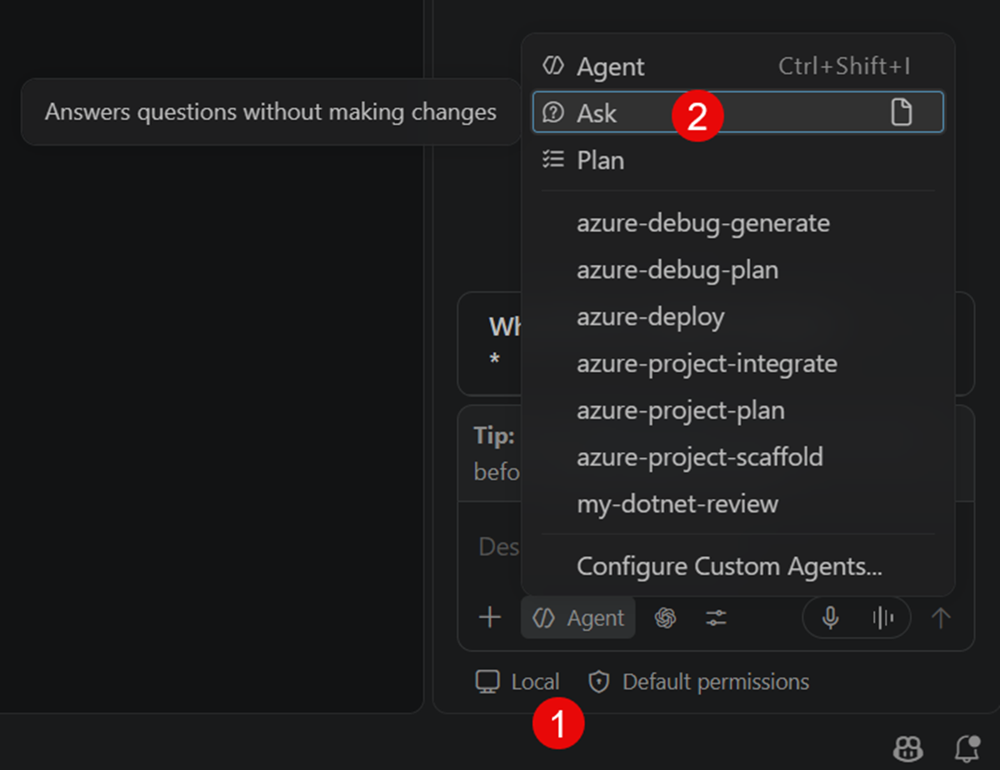
:::

## 容易混淆的 LLM 與 Harness 名稱{.scrollable}

Agent 使用的 Harness 和 LLM 是不一樣的東西，Harness 是用來管理代理的執行環境和資源，而 LLM 則是提供語言理解和生成能力的模型。使用者在設定代理時，可分別選擇合適的 Harness 和 LLM，以確保代理能正確執行任務。

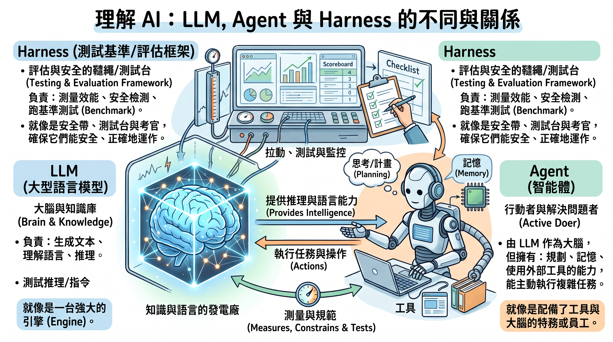{.lightbox}

目前 VSCode 除了 GitHub Copilot 提供的 Local Harness 外，還支援其他類型的 Harness，例如 Remote Harness，可將工作配發到 GitHub.com 的 Cloud Agent 環境中執行。

並且也開始支援 ***Claude Code***, ***Codex*** 等第三方 Harness extension，使用者能夠在 VSCode 中使用更多不同的代理執行環境。

[官方比較表](https://code.visualstudio.com/docs/agents/run/agent-harnesses#_compare-agent-harnesses){target="_blank"}

:::{.callout-note}
目前 VSCode 支援的第三方 Harness 與 LLM 名稱會讓使用者混淆，在與團隊成員溝通時需注意。
:::

## Agent Loop

&nbsp;

Understand  
    ↓  
Plan  
    ↓  
Implement  
    ↓  
Build  
    ↓  
Validate      
    ↓   
Fix(done)  

&nbsp;

通常在 Implement & Build 階段，代理產出的結果會無法立即達到最終目標，需要經過 Validate 與 Fix 階段的檢查與修正，然後回去重新修改 Implement 的內容再繼續，才能確保最終成果符合預期。

## Lab1: Compare Ask mode vs Agent mode

&nbsp;

[Lab1 GitHub 及詳細步驟](https://github.com/isak-ghcopilot-workshop/SmartTaskWorkshop/blob/main/README_ask_vs_agent.md){target="_blank"}

Ask mode 就類似傳統的 LLM 問答模式，使用者直接向模型提出問題，模型給出回答；而 Agent mode 則是透過代理自動或半自動地執行任務，可能涉及多步驟的計畫與執行。

## GitHub Copilot CLI

GitHub Copilot CLI 是一個命令列工具，允許使用者在終端機中與 GitHub Copilot 互動，執行各種與代理相關的操作，與 VSCode 中的 GitHub Copilot Chat 類似，但更適合在命令列環境下使用。

<https://docs.github.com/copilot/how-tos/copilot-cli>  
<https://github.com/github/copilot-cli>  

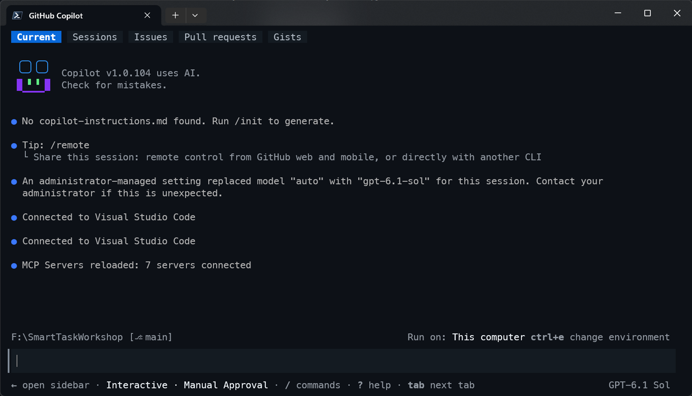{.lightbox}

#  Custom Instruction 實戰

## GitHub Copilot Custom Instruction

GitHub Copilot Custom Instruction 允許使用者自訂代理的行為與回應方式，使用者可以設定代理的角色、語氣、偏好等，以便代理在與使用者互動時能更符合使用者的需求與期望。

## 為什麼需要 Custom Instructions

通常我們會重複使用一些特定的要求或是 Prompt 模板:

```text
請求AI以特定角色回應
使用特定步驟或標準
套用固定的輸出樣式
```

這時候就可以透過 Custom Instructions 來設定代理的行為與回應方式，避免每次都需要手動輸入相同的內容。

## 使用 Custom Instructions 的Harness架構

使用 Custom Instructions 可以讓代理在接收到 User Prompt 後，加入使用者設定的行為與回應方式進行處理，並結合 Workspace Context 與 Source Code 來生成最終的回應。

&nbsp;

User Prompt  
      ↓  
Custom Instructions  
      ↓  
Workspace Context  
      ↓  
Source Code  
      ↓  
LLM generates response based on above inputs  

## Custom Instructions 種類＆建立位置

GitHub Copilot Custom Instructions 可以分為專案全域與針對特定檔案類這兩種：

&nbsp;

專案全域作用：

```
.github/
└─ copilot-instructions.md

```

&nbsp;

針對特定檔案類型：

```
.github/instructions/abcd/
                      └─ abcd.instructions.md
.github/instructions/defg/
                      └─ defg.instructions.md
```

&nbsp;

:::{.callout-note}
1. 針對特定檔案類型的 Custom Instructions 會覆蓋專案全域作用類型的設定，覆蓋順序請見[官方說明](https://docs.github.com/en/enterprise-cloud@latest/copilot/concepts/prompting-and-context/custom-instructions#precedence-of-custom-instructions){target="_blank"}。
2. 除了專案層級之外，也可以設定使用者層級的 Custom Instructions，而企業版GitHub 可以在管理網站上建立組織層級的 Custom Instructions。([官方說明](https://docs.github.com/en/enterprise-cloud@latest/copilot/concepts/prompting-and-context/custom-instructions#types-of-custom-instructions){target="_blank"})
3. 套用 Custom Instructions 不是讓 AI 變聰明，而是讓團隊不同成員在此專案工作時 AI 能保持一致的行為與回應方式。
4. Custom Instructions 只會影響代理在使用對話介面時的行為與回應方式。對於編輯程式碼時的自動補全或建議不會產生影響。
:::

## Custom Instructions 建立方式 {.scrollable}

除了手動自行在 `.github` 目錄內建立 Custom Instructions 的純文字檔案之外，

全域 Custom Instructions 可在 VSCode Chat View 的 GitHub Copilot 或是 GitHub Copilot CLI 中下 `/init` 指令建立。

::: {layout-ncol="2"}
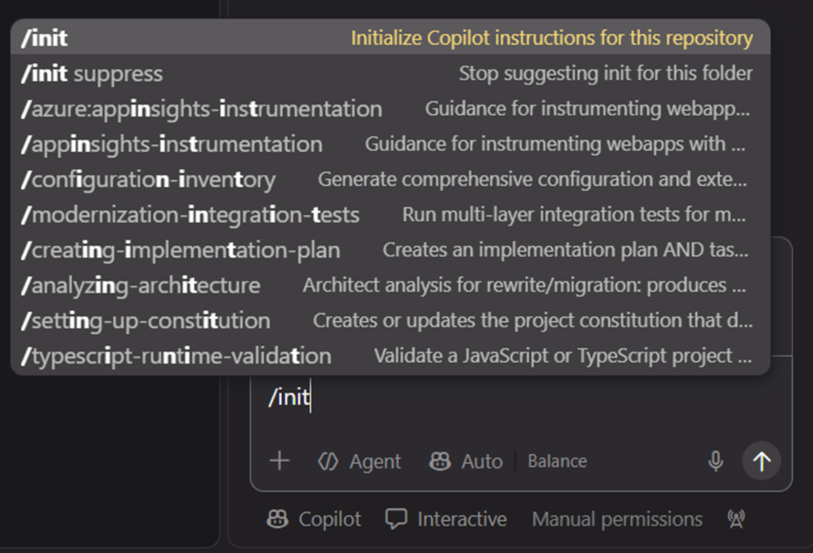{.lightbox}

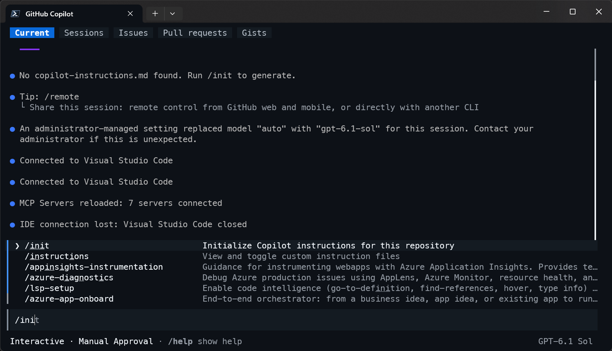{.lightbox}
:::

這兩種建立的方式都會掃描整個專案目錄，並自動生成對應的全域 Custom Instructions 檔案，省去自己手動從完全空白建立的麻煩。

在使用 `/init` 指令建立時，AI 會主動去掃描是否有其他第三方/公訂標準的 Markdown files，並將其內容納入考量，以生成更完整的 Custom Instructions。

::: {layout-ncol="2"}
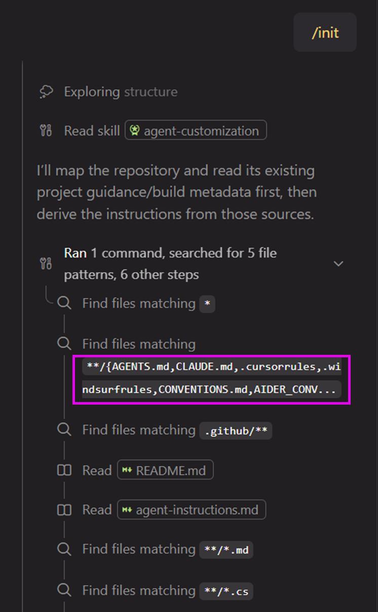{.lightbox}

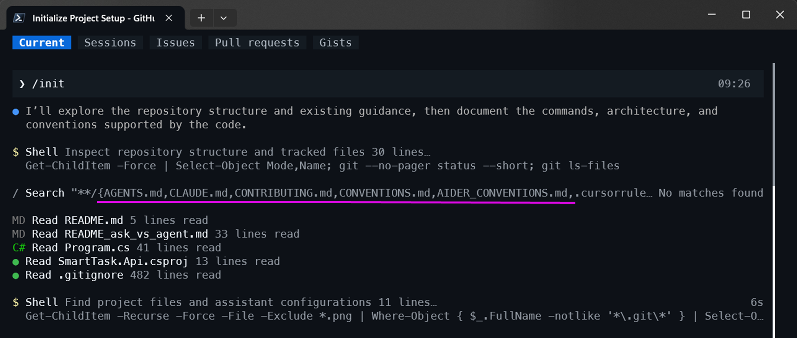{.lightbox}
:::

## 典型的 Custom Instructions 內容

典型的 Custom Instructions 內容通常會包括以下幾個部分\
（依據專案大小 AI 會自動調整）：

```text

# Repository Context (Repository Guide)

(## Projects and architecture)

這部分通常包含專案的基本資訊、目錄結構、重要檔案說明等，讓代理能夠理解專案的整體背景。

## Build and run (Build, test, and analysis)

這部分通常包含專案的建置與執行方式，例如所需的依賴、建置指令、執行指令等，讓代理能夠理解如何在本地環境中運行專案。

##　Architecture

這部分通常包含專案的整體架構設計、模組劃分、主要元件及其關係等，讓代理能夠理解專案的結構與設計理念。

## Code and configuration conventions (Project-specific conventions)

這部分通常包含專案的程式碼風格、命名規範、配置檔案結構等，讓代理能夠理解專案的程式碼與配置慣例。

```

可參見官方說明：[Writing Effective Custom Instructions](https://docs.github.com/en/enterprise-cloud@latest/copilot/concepts/prompting-and-context/custom-instructions#writing-effective-custom-instructions){target="_blank"}


Custom Instruction 不需要一定得用英文，可用專案團隊習慣語言撰寫。\
如[範例](https://github.com/windperson-demo-devops/GHAgenticWorkflowsDemo-SecretLeakDetector/blob/main/.github/copilot-instructions.md){target="_blank"}所示

## Lab2: 建立 Custom Instruction

&nbsp;
&nbsp;

[Lab2 GitHub 及詳細步驟](https://github.com/isak-ghcopilot-workshop/SmartTaskWorkshop/blob/main/README_custom_instructions.md){target="_blank"}

可比較，將 Lab1 產生的原始碼檔案都 `git clean -dxf` 檔案內容重設後，再依照 Lab2 的步驟建立 Custom Instruction 是否有不同。

或是建立 Custom Instruction 後，再下Prompt:

```text
Create Product API
```

觀察是否 AI 能夠根據建立的 Custom Instruction 正確生成對應 Clean Architecture 的程式碼或回應。

## Team Standard as AI Context

在專案中，團隊可能會有一些標準或慣例，例如程式碼風格、命名規範、提交訊息格式等。這些標準可以寫成 Custom Instructions，作為 AI 的上下文，幫助 AI 在生成程式碼或回應時遵循團隊的規範。

傳統沒導入 AI 前，團隊的標準通常只會以文件或口頭方式傳達，容易因人而異，且新成員需要花時間熟悉：

```
Wiki
Coding Standard
Confluence/Jira web site
      ↓  
Human Brain      
```


導入 AI 後，將團隊標準寫入 Custom Instructions，可以讓 AI 在生成程式碼或回應時自動遵循這些標準，減少人為差異，提升團隊協作效率：

```
Copilot Instructions
      ↓  
Copilot (AI Agent)
```

:::{.callout-note}
* 將團隊標準寫入 Custom Instructions，可以讓 AI 在生成程式碼或回應時自動遵循這些標準，減少人為差異，提升團隊協作效率。
* Documentation 告訴人看，Instructions 告訴 AI 做。
:::

# Agent Mode 深度解析

## Agent Mode ： 講 AI Agent 超脫到編輯器之外

GitHu Copilot Agent Mode 可將 AI 代理的執行範圍超脫到 Visual Studio / VSCode 編輯器之外，**Agent Host** 讓 AI 能夠在更多場景中協助開發者完成任務，例如在命令列、CI/CD 流程中，甚至與其他工具整合，提升開發效率與自動化能力。

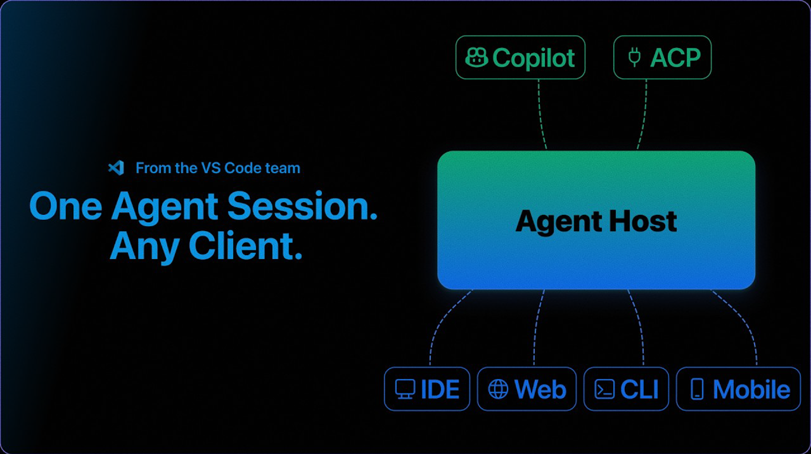

## Agent 執行流程

&nbsp;
&nbsp;

```
Analyze Project  
      ↓  
Create Plan  
      ↓  
Modify Files  
      ↓  
Build  
      ↓  
Fix Errors
```

## Agent Coding 工作流 Best Practices

&nbsp;

使用 Agent Mode 進行程式功能開發時，建議遵循以下最佳實踐，以確保開發過程高效且可控：

&nbsp;

✅ 小步驟

✅ 看 Plan

✅ 定期 Commit 成果檔案

✅ 驗證結果

&nbsp;

避免一次命令下達過多操作，應將任務拆解成小步驟，逐步執行，確保你有辦法審核每一步的結果，並確認每一步都能正確完成。

## Lab3: 使用 Agent Mode 進行程式開發

&nbsp;
&nbsp;

[Lab3 GitHub 及詳細步驟](https://github.com/isak-ghcopilot-workshop/SmartTaskWorkshop/blob/main/README_agent_mode.md){target="_blank"}

&nbsp;

可嘗試增加/減少目前專案的功能，觀察 AI 代理在不同情境下的表現，並驗證其是否能正確執行任務。

## 總結

在本章中，我們介紹了 GitHub Copilot 的 Agent Mode，並展示了如何使用 Agent Mode 進行程式開發。透過 Agent Mode，AI 代理可以超脫編輯器，協助開發者完成從分析專案、建立計畫、修改檔案到建置與修正錯誤的整個開發流程。同時，我們也介紹了使用 Agent Mode 的最佳實踐，確保開發過程高效且可控。

# Agent Skill 介紹與實作

## Agent Skill 介紹

AI Agent 可以透過不同的 Skill 來完成特定任務，例如程式碼生成、測試、部署等。每個 Skill 都封裝了一組能力，讓 AI 能夠在特定場景下高效執行任務。

:::{.callout-important}
可將 Agent Skill 視為寫給 AI 的插件，專門處理特定任務。
:::

## 為何要使用 Agent Skill

* 使用 Agent Skill 可以讓 AI 代理在特定任務上更高效地執行，減少重複性工作，提升開發效率。
* 透過 Skill 的封裝，團隊可以更容易地管理和擴展 AI 代理的能力，確保在不同場景下都能正確完成任務。
* Skill 可在不同專案上共用，提升團隊整體的開發效率與一致性。

:::{.callout-note}
Agent Skill 是一種讓LLM讀的行為操作 **說明書**，指導 AI 在特定任務中應該如何行動。
:::

## Agent Skill 結構

Agent Skill 的結構通常包含以下幾個部分：

- Metadata：描述 Skill 的基本資訊，如名稱、版本、作者等。(YAMLFrontmatter)
- Capabilities：定義 Skill 所能執行的任務或功能。
- Actions：具體的操作指令，指導 AI 如何完成特定任務。
- Inputs/Outputs：定義 Skill 所需的輸入資料及產生的輸出結果。
- References：列出與 Skill 相關的參考資料或文件。
- Constraints：限制條件，確保 AI 在執行任務時遵循特定規則。

在 GH Copilot 將放在 .github/skills/ 目錄下，每個 Skill 對應一個子目錄，內含 Skill 的定義檔案。

```
.github/skills/
  └─ my-skill/
      ├─ SKILL.md
      └─ ...
```

* 官方說明：  
  [https://code.visualstudio.com/docs/agent-customization/agent-skills](https://code.visualstudio.com/docs/agent-customization/agent-skills){target="_blank"}
  [https://docs.github.com/en/copilot/concepts/agents/about-agent-skills](https://docs.github.com/en/copilot/concepts/agents/about-agent-skills){target="_blank"}
*  GH Copilot支援 Agent Skill公訂規格\
   ([https://agentskills.io/specification](https://agentskills.io/specification){target="_blank"} )，可跨Coding Agent(Claude Code, Codex)共用Skill 


## Agent Skill 的加載與管理

* Agent Skill可設計成 Load on demand，節省Context/token花費
* 除了將Agent Skill 將其整個檔案結構copy到 .agent/skills/目錄底下使用，或是使用 Node.js 的 [『Skills』指令列工具](https://github.com/vercel-labs/skills){target="_blank"} 來從各個Git repo下載，抑或配合 VS Code 的 Agent Plugin 功能，可以更方便地管理和加載 Skill。
* 使用 GitHub CLI 也可以管理 Agent Skill，例如下載、安裝或移除 Skill。\
  [https://docs.github.com/en/enterprise-cloud@latest/copilot/concepts/customizations/agent-skills](https://docs.github.com/en/enterprise-cloud@latest/copilot/concepts/customizations/agent-skills){target="_blank"}
* .NET 生態系有另外一個MIT開源『dotnet-skills』全域工具可使用來管理/加載/移除 Agent Skill。
  * [範例練習](https://github.com/dotnet-mcp-lab/DotNetPrjSkillDemo/blob/main/README_use_dotnet-skills.md){target="_blank"}
    
## GitHub Copilot Chat 中使用 Agent Skill

除了隱含式的在 Prompt 中讓代理自己去理解到應該使用特定 Skill 外，\
GitHub Copilot Chat 也提供 slash command (**/skills**) 來明確指定LLM要去讀哪個 Agent Skill來使用。

官方說明：\
[https://code.visualstudio.com/docs/agent-customization/agent-skills#_use-skills-as-slash-commands](https://code.visualstudio.com/docs/agent-customization/agent-skills#_use-skills-as-slash-commands){target="_blank"}

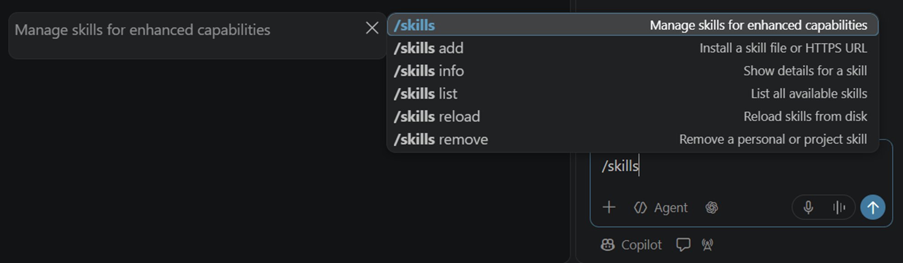

## Agent Skill 實作

* 官方說明：\
  [https://code.visualstudio.com/docs/agent-customization/agent-skills](https://code.visualstudio.com/docs/agent-customization/agent-skills){target="_blank"}
* 要記得在 GitHub Copilot 中使用的 Skill ***名稱必須是英文***
* 撰寫建議：
  [https://agentskills.io/skill-creation/best-practices](https://agentskills.io/skill-creation/best-practices){target="_blank"}
* 練習範例：
  [https://github.com/dotnet-mcp-lab/DotNetPrjSkillDemo/blob/main/README_custom_agent_skill.md](https://github.com/dotnet-mcp-lab/DotNetPrjSkillDemo/blob/main/README_custom_agent_skill.md){target="_blank"}

## Agent Skill Load on Demand

* 預設情況 Harness 只會在一開始時把目前安裝的 Agent Skill 的 Metadata 加載到記憶體中，實際的 Skill 內容會在需要時才加載。
* Reference部分就是讓單一 Agent Skill 還可以 Load on Demand 其他 Skill 的關鍵

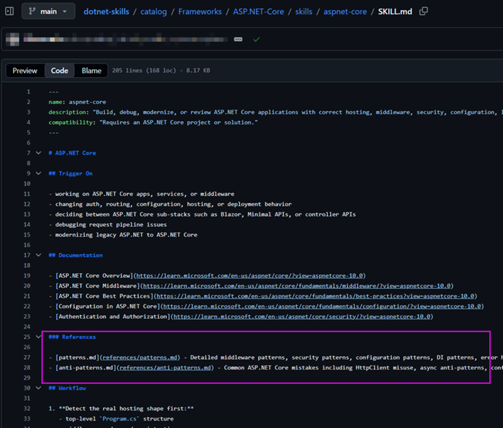{.center .lightbox}

## 在 Agent Skill 中呼叫命令列程式

* 在Skill裡敘述的一些命令列程式執行方法，在Agent Skill載入執行時會遵守並在需要執行時由 LLM 觸發執行：\
  [https://github.com/dotnet-mcp-lab/DotNetPrjSkillDemo/blob/main/.agents/skills/code-reviewer/SKILL.md?plain=1#L18](https://github.com/dotnet-mcp-lab/DotNetPrjSkillDemo/blob/main/.agents/skills/code-reviewer/SKILL.md?plain=1#L18){target="_blank"} 

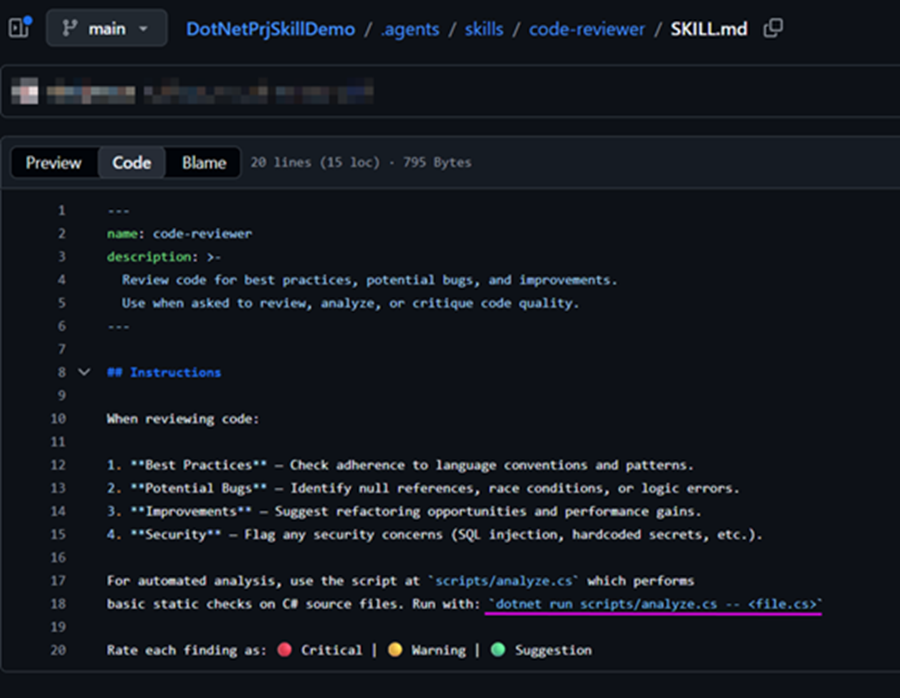{.center .lightbox}

## 總結

* Agent Skill 是一種可重用的功能模組，能夠在不同的 Coding Agent 中共用。
* 可以透過 Load on Demand 的方式節省資源，僅在需要時加載實際內容。
* GitHub Copilot Chat 提供 slash command (**/skills**) 來明確指定使用的 Skill。
* 在 Skill 中可以呼叫命令列程式，並由 LLM 觸發執行。
* 使用者應遵循最佳實踐來撰寫 Skill，並注意 Skill 名稱必須是英文。


# Agentic SDLC Workflow

## Agentic Coding 開發工作流


> 讓 GitHub Copilot 參與整個 SDLC(Software Development Life Cycle)。

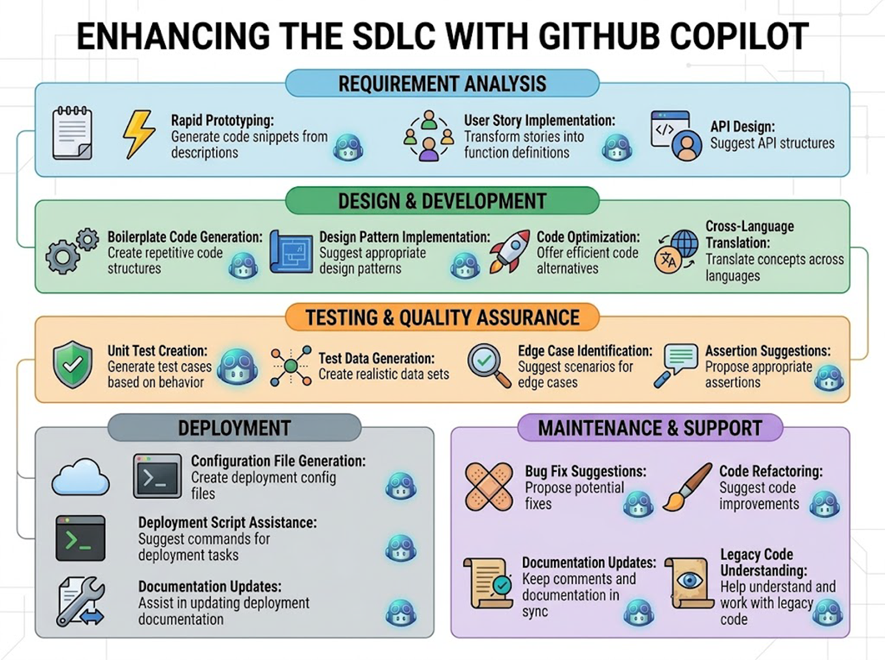{.center .lightbox}

## 

傳統的軟體開發流程中，開發者需要手動完成需求分析、設計、實作、測試與部署等各個階段，過程繁瑣且容易出錯。

&nbsp;
&nbsp;

需求  
↓  
設計  
↓  
開發  
↓  
測試  

## Agentic AI Workflow

在 Agentic AI Workflow 中，GitHub Copilot 會參與整個軟體開發生命週期，協助開發者完成需求分析、設計、實作、測試與部署等各個階段，提升開發效率並降低錯誤率。

&nbsp;
&nbsp;

需求分析  
&nbsp;↓  
設計草稿  
&nbsp;↓  
程式開發  
&nbsp;↓  
測試產生  
&nbsp;↓  
文件產生  
&nbsp;↓  
部署  

## Agentic Development Maturity Model

&nbsp;

大部分團隊目前還停留在 Level 1 或 Level 2，而真正的生產力提升通常從 Level 3 開始出現，Level 4 才開始形成團隊資產，Level 5 則是 Agentic Development 的目標狀態。

&nbsp;
&nbsp;

```
Level 1
Chat

Level 2
Instructions

Level 3
Agent

Level 4
Skills

Level 5
Agentic SDLC
```

## GitHub Copilot in Agentic Development

&nbsp;
&nbsp;

* 官方說明：[https://learn.github.com/product-guides/github-copilot/accelerate-usage/integrate-workflows](https://learn.github.com/product-guides/github-copilot/accelerate-usage/integrate-workflows){target="_blank"}

&nbsp;
* 官方舊版WorkShop：[https://github.com/pkal42/github-copilot-agents-in-sdlc/blob/main/docs/README.md](https://github.com/pkal42/github-copilot-agents-in-sdlc/blob/main/docs/README.md){target="_blank"}

## Future Developer

&nbsp;

不只是寫程式的人

而是：

> 能設計 Agent、規範 Agent、協作 Agent 的工程師。