# Agenda

* Agent Extensibility Overview
* Agent Hooks
* MCP 介紹
* Build MCP Server with .NET 10
* Custom Agent + Skills + MCP
* Build Custom Agent Plugin


# Agent Extensibility Overview

## GitHub Copilot Customization features {.scrollable}

官方說明：\
[GitHub Copilot Customization features](https://docs.github.com/en/copilot/concepts/customizations/comparing-customizations){target="_blank"}

名稱 | 可客製化
-----|:-----:
Custom instructions | ✅
Agent skills | ✅
Tools | ❌
MCP Server | ✅
Hooks | ✅
SubAgent | ❌ 
Custom Agents | ✅
Extensions | ✅
Plugins | ✅

其中 Extensions 需撰寫 JavaScript 程式且只能安裝在 GitHub Copilot app & GitHub Copilot CLI，其他可客製化的透過撰寫相關Prompt或設定檔(markdown, json)進行，故在此不對 Tools, SubAgent, Extensions 進行說明。

## Custom instructions

[https://docs.github.com/en/copilot/concepts/customizations/custom-instructions](https://docs.github.com/en/copilot/concepts/prompting-and-context/custom-instructions){target="_blank"}\
自訂指令（Custom instructions）讓使用者能夠為 GitHub Copilot 提供具體的指導，以規範其運作行為。這可以包含對程式碼風格、命名慣例或其他專案特定需求的偏好設定。

::: {.callout-note appearance="simple"}
* GitHub Copilot Custom Instructions 可以分為專案全域與針對特定檔案類兩種：


    專案全域作用：

    ```
    .github/
    └─ copilot-instructions.md

    ```

    針對特定檔案類型：

    ```
    .github/instructions/abcd/
                          └─ abcd.instructions.md
    .github/instructions/defg/
                          └─ defg.instructions.md
    ```

* 全域 Custom Instructions 可在 VSCode Chat View 的 GitHub Copilot 或 GitHub Copilot CLI 下 `/init` 指令建立。
:::

* 建議的範圍區分：\
  全域 copilot-instructions.md 負責專案規則，公訂標準『AGENTS.md([https://agents.md/](https://agents.md/){target="_blank"})』 負責 Agent 行為

## Agent skills

[https://docs.github.com/en/copilot/concepts/customizations/agent-skills](https://docs.github.com/en/copilot/concepts/customizations/agent-skills){target="_blank"}\
代理技能（Agent skills）允許使用者為 GitHub Copilot 定義特定的功能或行為。這些技能可以擴展 Copilot 的能力，使其能夠執行特定任務或與其他工具整合。

::: {.callout-note appearance="simple"}
* GH Copilot 將放在 ***.github/skills/*** 或 ***.agent/skills/*** 目錄下，每個 Skill 對應一個自命名子目錄，內含 SKILL.md 定義markdown檔案的目錄結構，視為一個 Agent skill。
      
    ```
    .github/skills/
      └─ my-skill/
          ├─ SKILL.md
          └─ ...
    ```
    
    或在 .agent/skills/ 目錄下：

    ```
    .agent/skills/
      └─ my-skill/
          ├─ SKILL.md
          └─ ...
    ```

    遵循 Agent skill 的公訂規範([https://agentskills.io/specification](https://agentskills.io/specification){target="_blank"})即可使用
* GH Copilot 使用 ["slash command"](https://docs.github.com/en/copilot/reference/github-copilot-app-reference/slash-commands){target="_blank"} (**`/skill名稱`**) 來明確指定LLM去讀哪個 Agent skill 來使用。
* 另有一個 `/skills` 指令，列出目前所有可用 Agent skills。
:::

GH Copilot 在 IDE (Visual Studio, VSCode, Xcode, JetBrains IDE) 中還有支援一個舊版的『[Prompt files](https://docs.github.com/en/copilot/concepts/prompting-and-context/prompt-files){target="_blank"}』功能，但 _[建議將其移轉至 Agent skill](https://code.visualstudio.com/docs/agent-customization/migrate-customizations#_convert-prompt-files-to-skills){target="_blank"}_。

## MCP Server

[https://docs.github.com/en/copilot/concepts/customizations/mcp](https://docs.github.com/en/copilot/concepts/customizations/mcp){target="_blank"}\
MCP Server 為 GitHub Copilot 提供擴展功能的伺服器端組件，使用者可以MCP Server 中定義自訂行為、整合外部服務，並與 Copilot 進行互動。

::: {.callout-note appearance="simple"}
* 在VSCode中使用MCP Server要在設定檔裡進行相關設定:
   * **.vscode/mcp.json** (舊版設定檔)
   * **.mcp.json** (新版設定檔)
* MCP Server 的設定通常包含伺服器端點、認證資訊以及其他與 Copilot 互動所需的參數。
* 目前支援的 MCP Server 有分為 stdio 和 http 兩種。
* GH Copilot 目前僅能使用 MCP Server 提供的 『Tools』 功能。
:::


## Hooks

[https://docs.github.com/en/copilot/concepts/customizations/hooks](https://docs.github.com/en/copilot/concepts/customizations/hooks){target="_blank"}\
Hooks 允許使用者在特定事件發生時，執行自訂的程式碼或行為。這使 GitHub Copilot 跑的代理能夠在不同的操作流程階段，觸發使用者定義的邏輯，實現更靈活的擴展。

::: {.callout-note appearance="simple"}
* Hooks [設定檔位置](https://docs.github.com/en/copilot/reference/hooks-reference#hooks-locations){target="_blank"}：
  - **.github/hooks/＊.json** (VSCode, GitHub Copilot CLI, Copilot cloud agent)
  - **~/.copilot/hooks/＊.json** (VSCode, GitHub Copilot CLI)
  - **~/.copilot/settings.json** (GitHub Copilot CLI)
* Hooks 非公訂標準，在 VSCode 還是預覽功能，尚無法與 Claude Code 的 Hooks 設定檔共用
:::

## Custom Agents

[https://docs.github.com/en/copilot/concepts/customizations/custom-agents](https://docs.github.com/en/copilot/concepts/customizations/custom-agents){target="_blank"}\
自訂代理（Custom Agents）允許使用者建立專屬的 GitHub Copilot 代理，以實現特定的功能或行為。這使得使用者能夠根據自身需求，擴展 Copilot 的能力。

::: {.callout-note appearance="simple"}
* Custom Agent 設定檔位置為 **.github/agents/＊.md**
* Custom Agent 設定檔架構類似 Agent skill，也是含有 YAMLForntmatter 的 markdown 格式檔案
* 可用Prompt Engineering中的『角色扮演』技巧來控制 Custom Agent 行為
* 可額外記載允許使用的 LLM Model、Tools、 MCP Server資訊
:::

切莫和公訂標準『AGENTS.md ([https://agents.md/](https://agents.md/){target="_blank"})』混淆，這是類似 Custom instructions ：\
[AGENTS.md and GitHub Copilot: How Copilot Reads It, What It Ignores, and How to Make It Work](https://thepromptshelf.dev/blog/agents-md-github-copilot-integration-2026/){target="_blank"}

[Custom Agent 範例](https://github.com/dotnet-mcp-lab/DotNetPrjSkillDemo/blob/main/README_custom_agent.md){target="_blank"}

## Plugins

[https://docs.github.com/en/copilot/concepts/customizations/plugins](https://docs.github.com/en/copilot/concepts/customizations/plugins){target="_blank"}\
插件（Plugins）允許使用者為 GitHub Copilot 增加額外的功能或整合。透過撰寫插件，使用者可以擴展 Copilot 的能力，並與其他工具或服務進行互動。

::: {.callout-note appearance="simple"}
* 插件的設定檔架構為 JSON 格式，記錄有：
  - MCP Server config
  - Custom Agent
  - Agent Skill
  - [Automation Templates](https://code.visualstudio.com/docs/agents/run/automations#_start-from-a-template){target="_blank"} (VSCode only)
  - Hook (not public standard)
  - LSP server config (not public standard)
* Plugin放在同電腦檔案目錄或是在 git repo 上的都可當安裝源
:::

Plugin 遵循『Agent Plugins([https://agent-plugins.org/](https://agent-plugins.org/){target="_blank"})』這個公訂標準，所以一些 Claude Code Plugin 也可使用，但支援程度請見[官方文件](https://code.visualstudio.com/docs/agents/reference/agent-plugin-reference#_cross-tool-compatibility){target="_blank"}

## 使用時機考量

* 從作用範圍/是否為公訂規格的角度來分類：
  * Custom Instructions – Copilot-instruction.md / AGENTS.md
  * Custom Agents – ***AgentName***.agent.md
  * Case-by-case – Prompt file / Agent Skill
  * Event-based – Hooks\
  (VSCode支援格式和專門給GH Copilot CLI/Copilot Cloud Agent用Hook格式有所不同)
  * Package/Distribute – Agent Plugin

* 官方建議分類：[GitHub Copilot Customization Handbook](https://copilot-academy.github.io/workshops/copilot-customization/copilot_customization_handbook#1-understanding-the-customization-landscape){target="_blank"}

# Agent Hooks

## Hooks {.scrollable}

* 官方說明：\
  - [Configure agent hooks in Visual Studio Code (Preview)](https://code.visualstudio.com/docs/agent-customization/hooks){target="_blank"}
  - [Introduction to hooks](https://code.visualstudio.com/learn/customizations/5-hooks){target="_blank"}
  - [Hooks for GitHub Copilot](https://docs.github.com/en/copilot/concepts/agents/hooks){target="_blank"}
* 在 AI Agent 執行工作流程到不同狀態時會觸發的Shell Script，目前支援 Bash & PowerShell script （類似 [Git Hooks](https://git-scm.com/book/en/v2/Customizing-Git-Git-Hooks){target="_blank"} 概念）
* 雖然其他 Coding Agent 如 Claude Code 也有Hook，但事件觸發機制名稱不同；且 GitHub Copilot CLI 支援的 Hook 事件種類比 VSCode GH Copilot 來得多(又是另一種版本的Hook)
* 在VSCode中，將設定檔(hook.json)以及配套呼叫的script檔案目錄等拷貝到 **.github/hooks** 目錄內即發揮作用
* User Level Hook 則根據作業系統不同而存放在不同的目錄，例如：
  * macOS / Linux: **~/.copilot/hooks**
  * Windows: **%USERPROFILE%\\.copilot\\hooks**
  * 假如有設定環境變數 `COPILOT_HOME` ，則會使用 **$COPILOT_HOME/hooks** 目錄

## Hooks 事件適用範疇 {.scrollable}

[GitHub Copilot CLI Hooks 種類](https://docs.github.com/en/copilot/concepts/customizations/hooks#types-of-hooks){target="_blank"}

事件名稱 | 說明 | 觸發時機 | 用途
--- | --- | --- | ---
`sessionStart` | Agent Session啟動 | 於 Session 開始時 | 注入初始log記錄
`userPromptSubmitted` | 使用者送出 Prompt | 使用者提交 Prompt ，LLM回應前 | 記錄使用者輸入的 Prompt
`preToolUse` | Tool 執行前 | Agent 要呼叫任何Tool之前 | 審核或記錄將使用之Tool
`postToolUse` | 成功的 Tool 執行後 | Tooling 回傳成功| 格式化回傳結果
`errorOccurred`| Tool 執行失敗或是有其他系統錯誤 | Tooling 回傳失敗、拋出錯誤訊息 | 記錄錯誤訊息，便於追蹤和偵錯
`agentStop` | Agent 停止 | 主 Agent 完成task，準備輸出回應時 | 驗證最終結果
`subagentStop` | 子 Agent 停止 | 子 Agent 完成task<br/>(多Agent情境) | 彙整證最終結果
`sessionEnd` | Session 結束 | 整個 Session 完全結束時 | 記錄整個 Session 的結果、清理資源

::: {.callout-caution}
與[目前 VSCode 中使用的 Hook 事件名稱](https://code.visualstudio.com/learn/customizations/5-hooks#_lifecycle-events-where-hooks-run){target="_blank"} 以及 [GH Cloud Agent 的 Hook 事件名稱](https://docs.github.com/en/copilot/reference/hooks-reference#hook-events){target="_blank"} 均有稍微不同
:::

## Lab6: Session Logger hook {.scrollable}

&nbsp;\ 
&nbsp;\ 

[Lab6 GitHub 詳細步驟](){target="_blank"}

&nbsp;\ 
&nbsp;\ 
 
範例執行畫面：

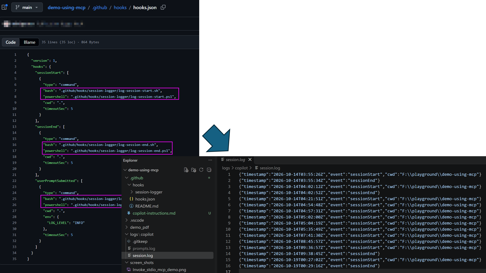{.center .lightbox}

原始範例來源：[https://github.com/github/awesome-copilot/tree/main/hooks/session-logger](https://github.com/github/awesome-copilot/tree/main/hooks/session-logger){target="_blank"}

## Hooks 範例

* [Awesome GitHub Copilot Hooks 範例](https://github.com/github/awesome-copilot/tree/main/hooks){target="_blank"}
* [Agent Hooks Demo](https://github.com/htekdev/agent-hooks-demo/tree/main){target="_blank"}

# MCP 介紹

* MCP 簡介
* VSCode 使用 MCP (MSLearn、GitHub、MarkItDown)

## MCP 簡介

* 整合 AI Agent 各種外部工具呼叫的通訊協定(JSON-RPC)
   [https://modelcontextprotocol.io/](https://modelcontextprotocol.io/){target="_blank"}
   [https://github.com/modelcontextprotocol](https://github.com/modelcontextprotocol){target="_blank"}
* Ver 2.0 重新定為 State-less 的通訊協定

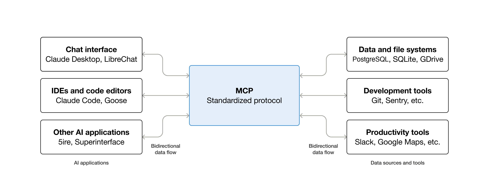{.center}

## MCP 術語與架構 {.scrollable}

* 實務上會由 Agent Harness 框架擔任 MCP Host 的角色，讓承載的 LLM 做為 MCP Client來使用 MCP 呼叫
* Ver2.0的MCP Server底層實際通訊機制為本機端(stdio)以及遠端(http, streamable-http), SSE deprecated

](./pics/MCP_arch.png){.center .lightbox}

## VSCode 使用 MCP {.scrollable}

* 在VSCode上使用MCP Server，其實就是在設定檔裡添加設定:\
  [https://code.visualstudio.com/docs/agent-customization/mcp-servers](https://code.visualstudio.com/docs/agent-customization/mcp-servers){target="_blank"} 
* 設定檔有新舊兩種版本，檔案位置以及格式不同(建議往新版本升級）
  * Old(VSCode only): `.vscode/mcp.json`
  * New(Portable): `.mcp.json`
  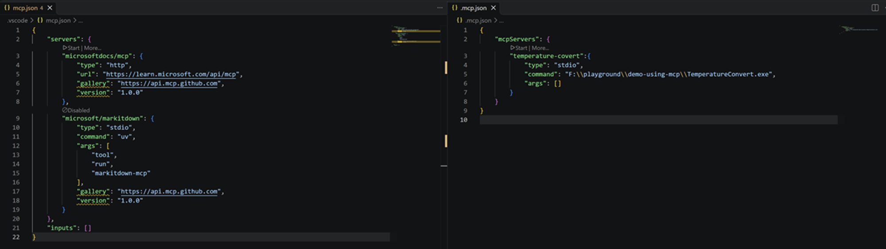{.lightbox}
* 使用目前VSCode的UI功能設定時，在專案中沒有舊版設定檔時，優先建立新版設定檔
* 除了專案範圍的設定檔之外，還可以有使用者範圍的設定檔，通常位於使用者主目錄下的 `.mcp.json`，或是設定 `COPILOT_Home` 環境變數指定位置的設定檔：[https://code.visualstudio.com/docs/agent-customization/mcp-servers#_choose-a-configuration-destination](https://code.visualstudio.com/docs/agent-customization/mcp-servers#_choose-a-configuration-destination){target="_blank"}
* 除設定檔之外，stdio的類型由於是呼叫本機的命令列程式，有些需要額外的程式/套件安裝流程，詳閱該MCP Server的說明文件
* 遠端MCP Server認證，標準上是[遵循 OAuth 2.1 協定進行認證](https://modelcontextprotocol.io/docs/2026-07-28/tutorials/security/authorization){target="_blank"}
* 較舊MCP Server則須在 MCP 設定檔填入API金鑰之類的設定

## VSCode 使用 MCP Marketplace 安裝 MCP Server {.scrollable}

1. 快速鍵 Ctrl(Cmd)+Shift+P 搜尋 MCP:
  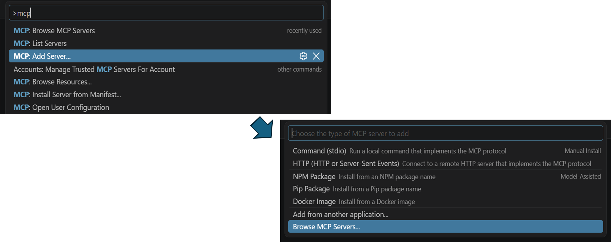{.center .lightbox}
2. 導引至 VSCode Agent Window 的 Agent Customization 設定頁面，選擇 MCP Servers 進行安裝與設定:
  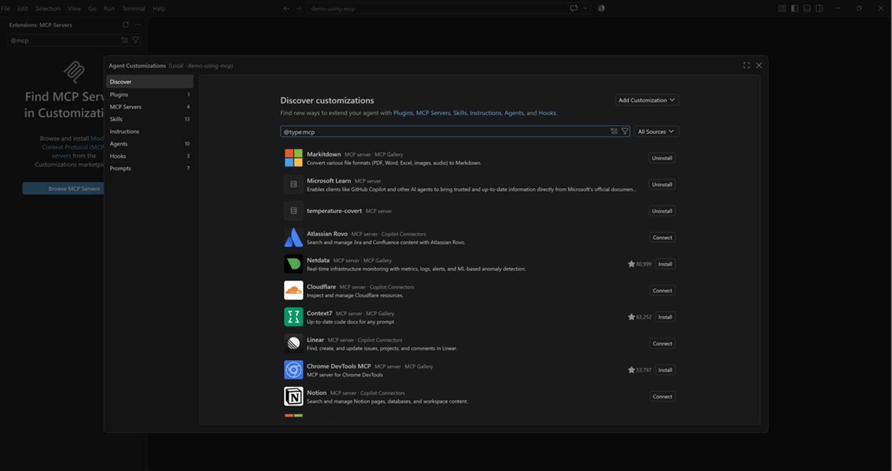{.center .lightbox}
3. 安裝好之後，可能還需要自行至設定檔中進行額外的設定，或是安裝所需的程式/套件，詳閱該 MCP Server 的說明文件。

:::{.callout-tip}
所有的 MCP Server 可由 **`MCP: Show Installed Servers`** 快捷命令來開啟設定介面
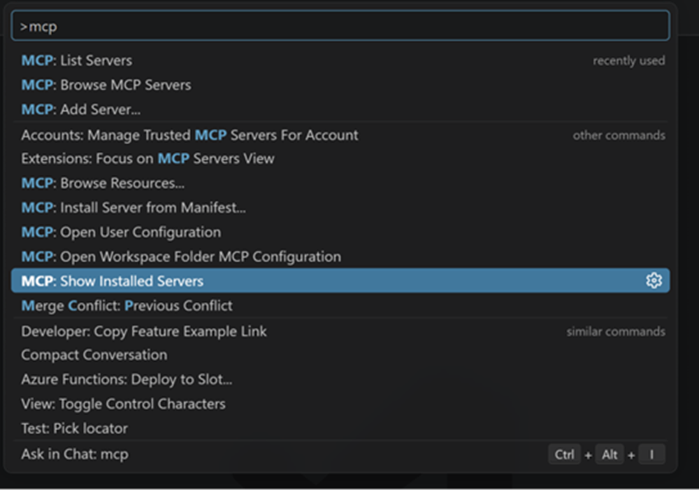{.center .lightbox}
:::

## VSCode 設定 MS Learn MCP Server {.scrollable}

* MS Learn MCP Server 可讓 Agent 查找 MS Learn 網站文章/範例程式碼  
  [https://learn.microsoft.com/training/support/mcp](https://learn.microsoft.com/training/support/mcp){target="_blank"}

* 假如先前已經隨 VSCCode 早期版本內建而安裝過，在 Agent Customization 設定頁面會額外顯示可點選進行『Migrations』超連結：
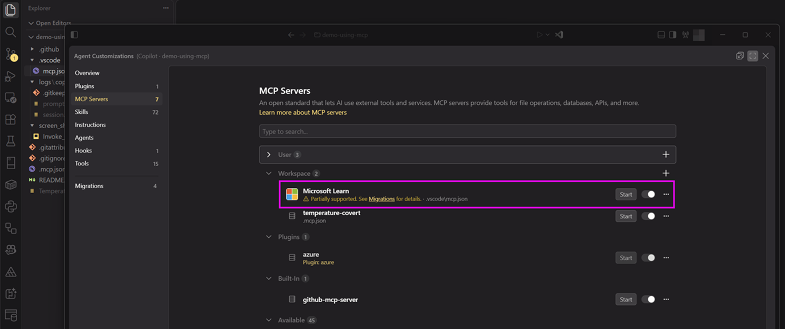{.center .lightbox}

安裝完成之後應該會有如下的 json 設定：

```json
{
  "mcpServers": {
    "microsoft-learn": {
      "tools": [
        "*"
      ],
      "type": "http",
      "url": "https://learn.microsoft.com/api/mcp"
    },
    // 其他 MCP Server 設定
  }
}
```

## VSCode 使用 MS Learn MCP Server 範例 {.scrollable}

在跟 AI 對話時如果有些問題 Agent 使用的LLM模型不懂，會嘗試使用 MS Learn MCP Server獲取資訊：

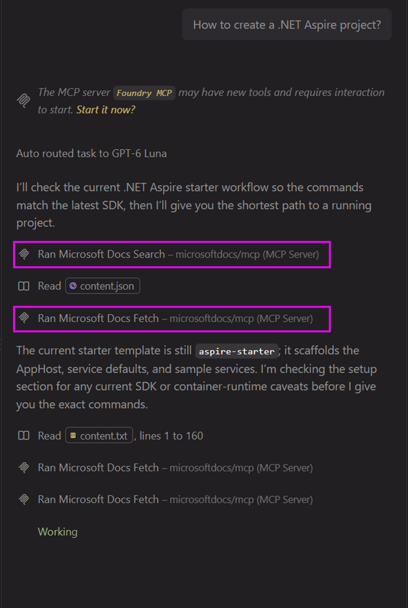{.center .lightbox}

也可以撈取 Sample Code：

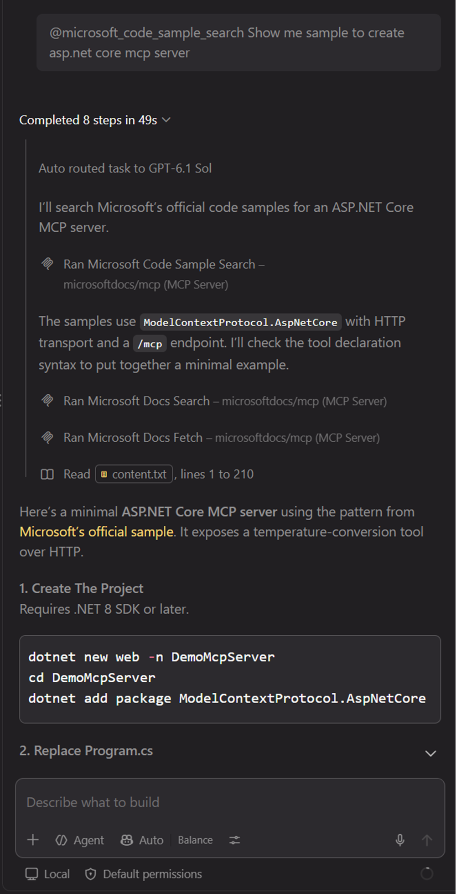{.center .lightbox}

## VSCode 設定 GitHub MCP Server {.scrollable}

* GitHub MCP Server 可對特定 GitHub repository做各種動作：<br/>[https://github.com/github/github-mcp-server](https://github.com/github/github-mcp-server){target="_blank"}
* 新版的 VSCode 直接內建 GitHub MCP Server，無需額外安裝:
  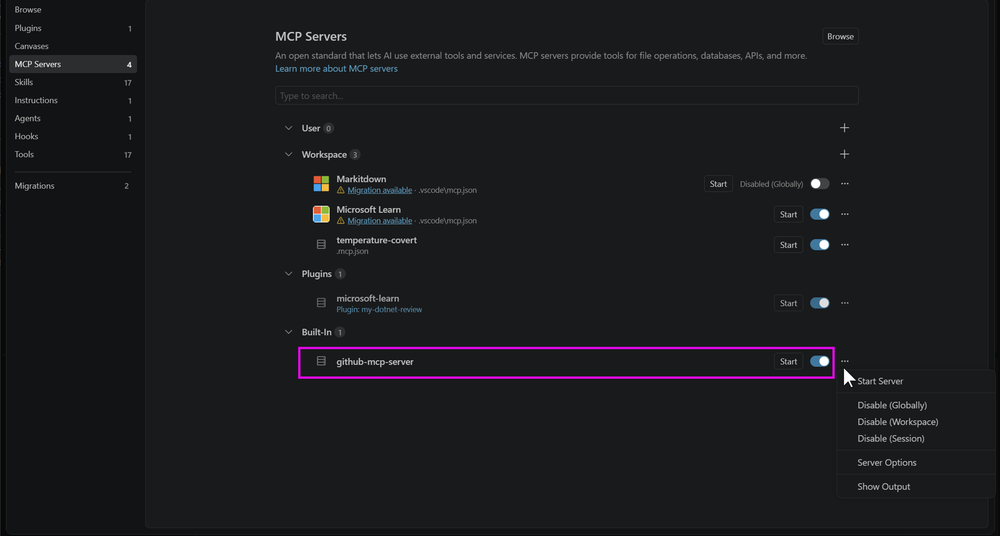{.center .lightbox}
* 也可以直接手動改設定檔，使用 OAuth 進行認證：<br/>[https://github.com/github/github-mcp-server#install-in-vs-code](https://github.com/github/github-mcp-server#install-in-vs-code){target="_blank"}
   
    ```json
    {
      "mcpServers": {
          "github": {
            "type": "http",
            "url": "https://api.githubcopilot.com/mcp/",
            "tools": [
              "*"
            ]
          },
        // 其他 MCP Server 設定
        }
    }
    ```

## VSCode 使用 GitHub MCP Server {.scrollable}

第一次使用時會提示並引導開啟網頁做OAuth登入

之後就可以直接使用，例如 git pull 再用VSCode開啟[ OpenClaw.NET 的 GitHub 專案](https://github.com/clawdotnet/openclaw.net){target="_blank"}後，直接問 AI 得知是否有哪些破壞性版本變更：  
```text
Use GitHub MCP Server to list what are likely have breaking changes in this repo?
```
   
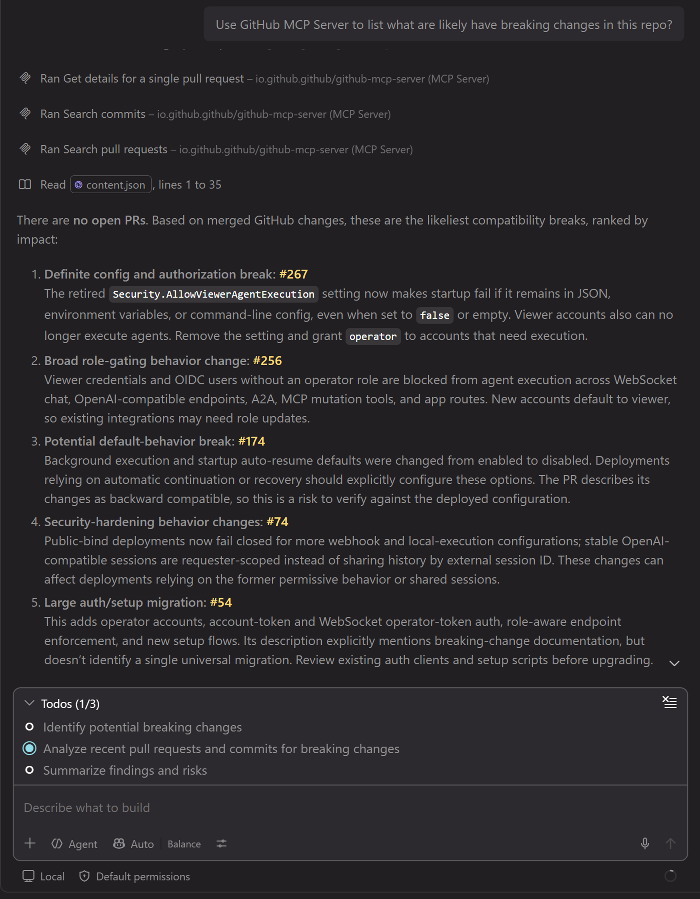{.center .lightbox}


## VSCode 設定  MarkItDown MCP Server {.scrollable}

* MarkItDown MCP Server: [https://github.com/mcp/microsoft/markitdown](https://github.com/mcp/microsoft/markitdown){target="_blank"} 
* 可用來擷取PDF/docx/xlsx檔案內容並轉換為Markdown格式內容，便於後續LLM AI使用
* 這是 stdio 模式的 MCP Server，建議設定前先安裝 uv 命令列之後，再由 uv 安裝 markitdown-mcp 全域命令列
   
   ```sh
   uv tool install markitdown-mcp@latest
   ```

   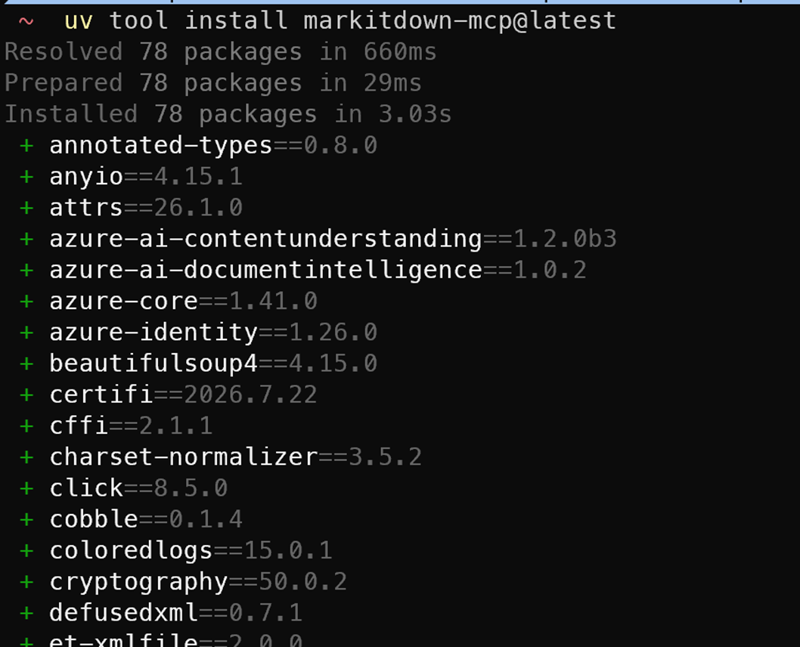{.center .lightbox}

## Lab7: VSCode 使用 MarkItDown MCP Server {.scrollable}

&nbsp;\ 

[Lab7 GitHub 詳細步驟](https://github.com/dotnet-mcp-lab/demo-using-mcp/blob/main/README_markitdown.md){target="_blank"}

&nbsp;\ 

範例執行畫面：

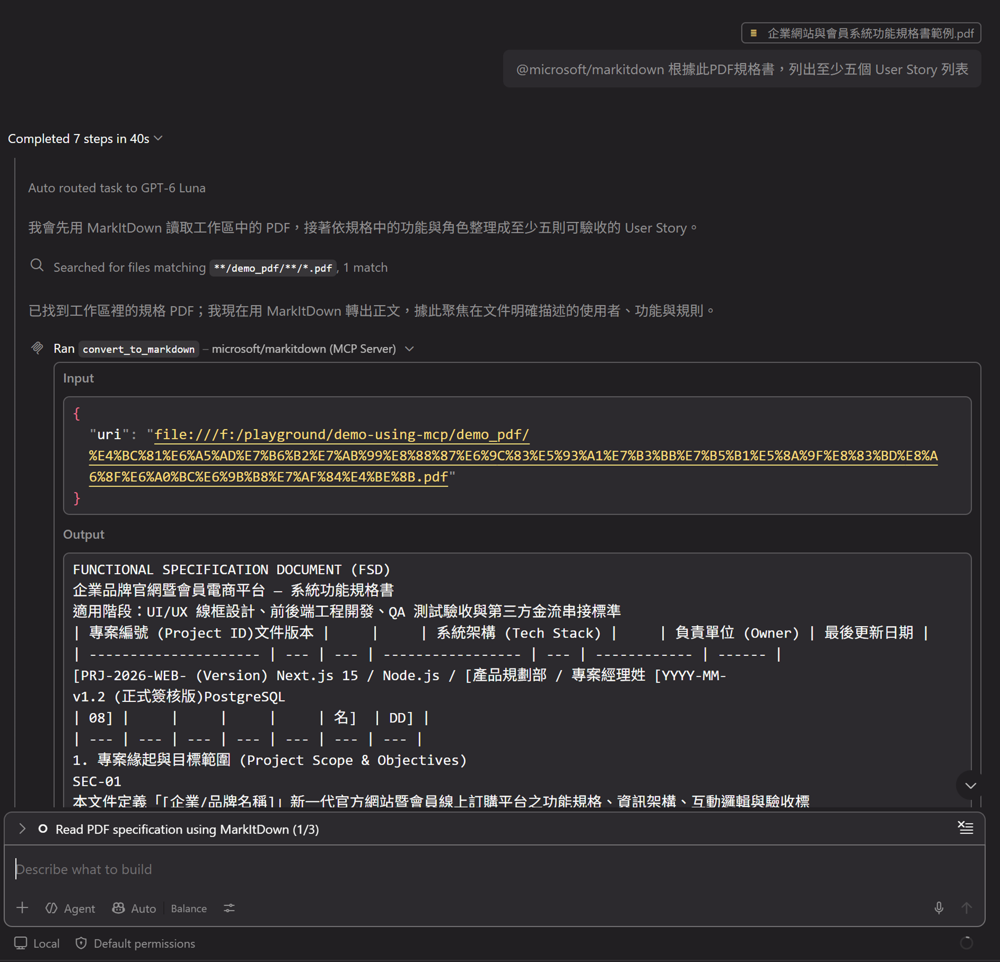{.center .lightbox}


# Build MCP Server with .NET 10

## 自製地端MCP Server {.scrollable}

* MCP C# SDK 最主要是提供了MCP endpoint的 C# Attribute，套用在 C#類別 & 方法程式碼上
* 在 C#方法上Attribute 的Description敘述為 LLM 查找/使用此方法的依據，需確實完善填寫，避免語意模糊或多個方法相似
* 在 C#類別的Attribute為便於 hosting程式碼註冊MCP端點使用，如果是手動註冊該C#類別為MCP端點，就可不必套用該Attribute


## Lab8 自製地端MCP Server {.scrollable}

使用 MCP C# SDK 建立命令列程式然後設定為地端 MCP Server

* 先建立一個新的 .NET 10 命令列專案
* 安裝 MCP C# SDK 套件
* 實作 MCP Server 的邏輯
* 在 VSCode 設定中加入此地端 MCP Server 的資訊

1. 溫度轉換範例程式：<br/>[https://github.com/dotnet-mcp-lab/CSharpMcpDemo/tree/main/MCPServer/TemperatureConvert](https://github.com/dotnet-mcp-lab/CSharpMcpDemo/tree/main/MCPServer/TemperatureConvert){target="_blank"}
2. 使用 .NET SDK 編譯成單一命令列程式之後，複製到 demo-using-mcp 專案內使用：<br/>[https://github.com/dotnet-mcp-lab/demo-using-mcp](https://github.com/dotnet-mcp-lab/demo-using-mcp){target="_blank"}

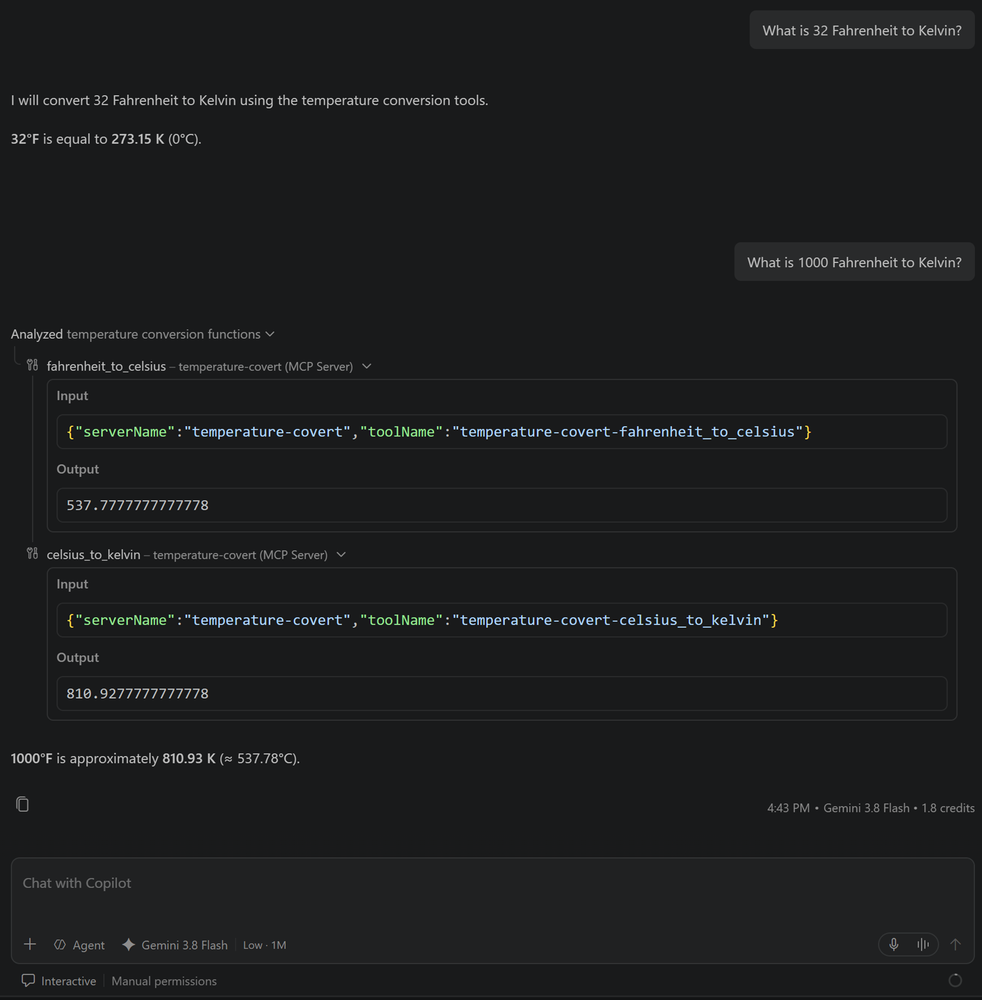{.center .lightbox}

在使用此 MCP Server 時，可能會碰到某些太簡單的換算情況，LLM AI會直接背答案回應

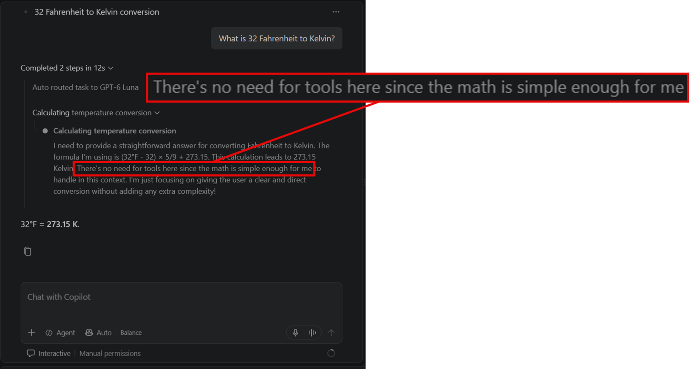{.center .lightbox}

## Lab9 自製雲端MCP Server (ASP.NET Core) {.scrollable}

* 示範如何串接現有的REST API (JSONPlaceholder)轉換為MCP Server
  [範例程式碼](https://github.com/dotnet-mcp-lab/CSharpMcpDemo/tree/main/MCPServer/JsonPlaceHolder/JsonPlaceHolderApiToMCP){target="_blank"}
* 為 ASP.NET Core minimal API 專案裝 ModelContextProtocol.AspNetCore 這個 MCP SDK Nuget 套件：
  [Nuget 套件](https://www.nuget.org/packages/ModelContextProtocol.AspNetCore/){target="_blank"}

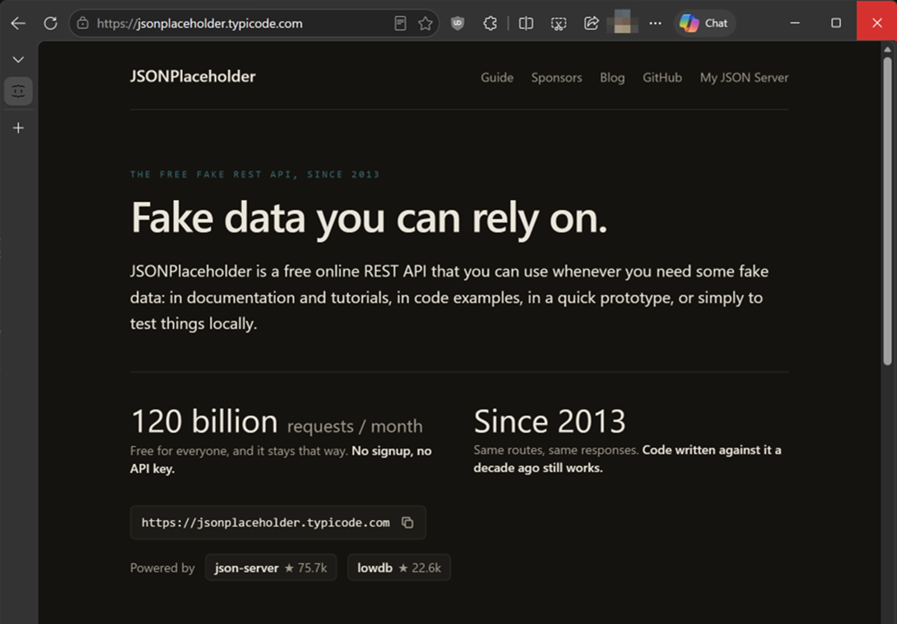{.center .lightbox}

* 程式碼就是在 MCP endpoint方法內使用httpclient呼叫JSONPlaceholder網站的 REST API
* MCP endpoint方法輸入參數也可使用 [Description] 這Attribute來增加metadata敘述，以便讓取用的LLM AI知道該參數用途/值範圍

* 在VSCode內要使用前，先將專案跑起來之後，加上 MCP 設定檔的設定

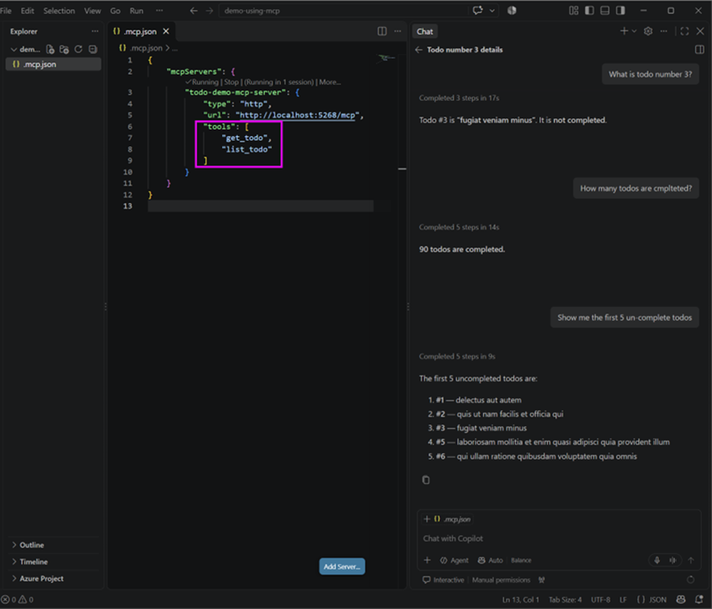{.center .lightbox}

:::{.callout-tip}
可以再自行加上該MCP Server可用的 MCP tool 名稱，省去LLM偵測的時間
:::

### Lab10 自製雲端MCP Server (Azure Function) {.scrollable}

* Azure Function版的串接JSONPlaceholder轉換為MCP Server
  [範例程式碼](https://github.com/dotnet-mcp-lab/CSharpMcpDemo/tree/main/MCPServer/JsonPlaceHolder/AzFunc.JsonPlaceHolderMCP){target="_blank"}
* 使用 Azure Function SDK 的 MCPToolTrigger實作MCP endpoint:
  [教學文件](https://learn.microsoft.com/azure/azure-functions/functions-bindings-mcp-tool-trigger?pivots=programming-language-csharp){target="_blank"}
* Azure Function啟動後會有對應的 Tool Trigger 可供LLM AI呼叫

在 VSCode 內執行起來會列出可呼叫的 MCP Tool Trigger 列表

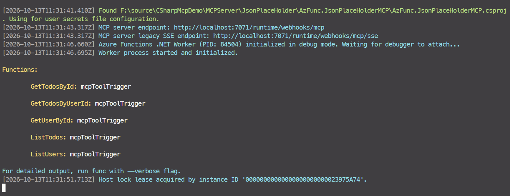{.center .lightbox}

## Debug MCP Server {.scrollable}

除了直接設定 VSCode Coding Agent 串MCP Server之外，也可用不消耗token的方式驗證 MCP Server：
MCP Inspector ([https://github.com/modelcontextprotocol/inspector](https://github.com/modelcontextprotocol/inspector)){target="_blank"}
需安裝Node.js v22以上版本
POSTMan App ([https://www.postman.com/downloads/](https://www.postman.com/downloads/)){target="_blank"}

以下示範使用 MCP Inspector 接 ASP.NET Core 的 MCP Server
使用命令列啟動網頁UI

```sh
npx @modelcontextprotocol/inspector
```

啟動後會在瀏覽器中開啟 MCP Inspector 的網頁介面，並列出可呼叫的 MCP Tool 列表

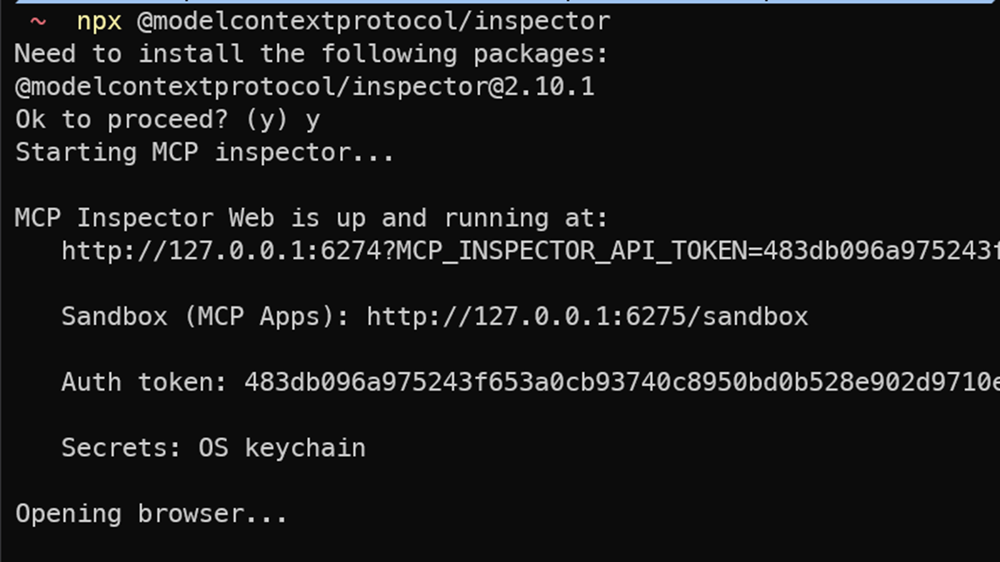{.center .lightbox}


# Custom Agent + Skills + MCP

# Build Custom Agent Plugin