# Agenda

* GHCopilot 自訂功能回顧與 Agentic E2E Testing 概念
* GHCopilot + Playwright MCP 與 Browser Agent 測試
* Playwright CLI 與 GitHub Copilot 整合
* 使用 GHCopilot 產生 Playwright E2E Tests case
* E2E Test Debug、Diagnose、Fix 與 Retest
* Agent Skills + MCP + CLI 的 Agentic Testing Workflow
* Hands-on: Blazor WebAssembly E2E Tesing Challenge & QA

# GHCopilot 自訂功能回顧與 Agentic E2E Testing 概念

## GHCopilot 自訂功能回顧

GHCopilot 自訂功能允許使用者根據自身需求擴展 Copilot 的能力：

名稱 | 可客製化
-----|:-----:
Custom instructions | ✅
Agent skills | ✅
Tools | ❌
MCP Server | ✅
Hooks | ✅
SubAgent | ❌ 
Custom Agents | ✅
Extensions | ✅
Plugins | ✅

## Agentic E2E Testing 概念

Agentic E2E Testing 是一種結合 GitHub Copilot 的 Agent Skills、MCP Server 與 CLI 工具的端對端測試方法。它的核心理念是：

- 使用 Agent Skills 自動化測試流程中的各個步驟
- 透過 MCP Server 溝通 E2E 測試工具，實際進行測試
- AI代理呼叫工具執行、監控與管理測試

這種方法能夠提高測試的自動化程度，減少人工干預，並提升測試的可靠性與效率。

## Agentic E2E Testing v.s. 傳統 E2E Testing {.scrollable}

傳統的 E2E Testing 主要依賴人工編寫測試腳本，通過CLI工具執行測試，缺乏自動化協調與智能化管理，是一件非常耗時的工作。

```{=html}
<pre>
  Requirement
   ↓
  Developer / QA
   ↓
  Write Test
   ↓
  Run Test
   ↓
  Failure
   ↓
  Read Error
   ↓
  Debug
   ↓
  Fix
   ↓
  Run Again
</pre>
```
* Test case 要人工撰寫
* UI Locator 容易隨著產品版本快速更新而一直壞
* Debug Test Failure 花時間
* Fail → Diagnose & Debug → Fix → Retest 大量人工介入


Agentic E2E Testing 則利用 AI 代理自動化協調測試流程，減少人工自行製作測試腳本的需求，提高測試效率與可靠性：

```{=html}
<pre>
  Coding Assistant
    ↓
  Generate Code

  E2E Agent
    ↓
  Understand
    ↓
  Plan
    ↓
  Act ←─────────────────────┐
    ↓                       │
  Observe                   │
    ↓                       │
  Fix ──────────────────────┘ AI Agent 在修復後持續 Re-test
    ↓
  Verify
</pre>
```

\

不考量AI token 消耗的情況下，Agentic E2E Testing 可以顯著提高 E2E 測試的自動化程度與效率，減少人工所需時間精力。

::: {.callout-note}
Testing 本身其實就是非常典型的 "_Agent Loop_"，包含觀察、計劃、行動與反饋的循環過程。

```{=html}
<pre>
  Goal
  ↓
  Agent
  ├─ Explore UI
  ├─ Understand Behavior
  ├─ Generate Tests
  ├─ Execute Tests
  ├─ Observe Failure
  ├─ Diagnose
  ├─ Fix
  └─ Retest
        ↑
        └──────── Agent Loop
</pre>
```
:::

## Agentic E2E Testing 所需能力/實現工具

\
\

所需能力 | 實現工具
-----|:-----:
Reasoning | GitHub Copilot
Browser Interaction | Playwright
Playwright Agent Automation | Playwright MCP
CLI Automation | Playwright CLI
Reusable Knowledge | Agent Skills

# GHCopilot + Playwright MCP 與 Browser Agent 測試

## What is Browser Agent? {.scrollable}

\
Browser Agent 是一種能夠自動化瀏覽器操作的 AI 代理，通常用於端對端測試中。它能夠理解測試需求，生成測試計劃，執行測試步驟，觀察結果，並在必要時進行修復與重測。透過 Browser Agent，可以大幅提高 E2E 測試的自動化程度與效率。
\


```{mermaid}
flowchart TD
    A["GitHub Copilot"] -->|"Instructs / Emits Actions"| B["Browser Tool"]
    B -->|"Executes Events / Inspects DOM"| C["Web Application"]

    classDef default fill:#1f2937,stroke:#3b82f6,stroke-width:1.5px,color:#f9fafb;
    classDef tool fill:#111827,stroke:#10b981,stroke-width:1.5px,color:#f9fafb;
    class B tool;
```

配合 Playwright MCP，AI 代理可以自動化瀏覽器操作，實現端對端測試的全流程自動化。 AI 代理不再只是產生程式碼，而是能夠直接與瀏覽器互動，完成測試任務。

這樣的分層架構設計可讓 AI 代理不需要輸出具體的 DOM 操作細節，只需專注於高層次的測試指令與策略，降低了測試腳本的維護成本。

## Playwright

\

* Web End-to-End Testing Framework/tool
  * [https://playwright.dev/](https://playwright.dev/){target="_blank"}
  * [https://github.com/microsoft/playwright](https://github.com/microsoft/playwright){target="_blank"}

* Code-based testing, Support Js/Typescript, Python, Java, .NET C#
  * [https://playwright.dev/docs/languages](https://playwright.dev/docs/languages){target="_blank"}
  * 新功能會先在 JavaScript/TypeScript 上實現，其他語言稍晚支援。<br/>(VSCode擴充套件的除錯目前也只支援 JavaScript/TypeScript)

## Why Playwright?

\

* Cross-browser : Chromium/Edge, Firefox, WebKit from one API
* Auto-waiting and web-first assertions cut flaky tests
* Fast feedback: parallel workers, browser contexts, reusable auth state
* Built-in debugging: trace viewer, screenshots, video, UI mode
* Codegen records real user flows into runnable test code
* CI-ready: official Docker images and GitHub Actions support


## Playwright MCP {.scrollable}

[Playwright MCP](https://playwright.dev/docs/getting-started-mcp){target="_blank"} 提供 browser automation，而且主要透過 structured accessibility snapshot 讓 LLM 與頁面互動。

* Playwright MCP server 為 Apache-2.0 授權的開源軟體：<br/>[https://github.com/microsoft/playwright-mcp](https://github.com/microsoft/playwright-mcp){target="_blank"}
* 在 VSCode GitHub Copilot 的環境下使用 Playwright MCP server，需要安裝 [Node.js](https://nodejs.org/){target="_blank"} 並配置相關的 Playwright MCP 設定。

  ```json
  {
    "mcpServers": {
      "playwright": {
        "command": "npx",
        "args": [
          "@playwright/mcp@latest"
        ]
      }
    }
  }
  ```

從設定的指令列看出這是 stdio 模式的 MCP Server，在不需安裝全域套件的情況下用 [Node.js 的 npx 指令](https://docs.npmjs.com/cli/v12/commands/npx){target="_blank"} 來啟動 Playwright MCP。

Playwright MCP提供了一個 _標準接口_，使 AI 代理能夠與瀏覽器進行互動，無需直接操作 DOM。因為 Playwright MCP 支援主流的 Edge, Chrome, Firefox 等瀏覽器，AI 代理可以在不同瀏覽器環境下執行測試，保證測試的廣泛適用性與可靠性。

\

Playwright MCP 支援的瀏覽器操作包括：

* Navigation: Open URLs, go back/forward, reload pages.
* Clicking and typing: Click elements, type text, fill forms, select dropdowns.
* Screenshots: Capture the current page or specific elements for visual verification.
* Keyboard and mouse: Press keys, hover, drag and drop.
* Dialogs: Accept or dismiss browser dialogs.
* Tabs: Create, close, and switch between browser tabs.

除操作瀏覽器之外，Playwright MCP 還能夠建立目前瀏覽器網頁的 snapshot 快照(結構化文件或截圖)，方便 AI 代理進行網頁結構或視覺上的檢查與比對，進一步提升測試的準確性與可靠性

## Lab12: Playwright MCP 讓 GitHub Copilot 自己探索網站 {.scrollable}

\ 

[Lab12 操作步驟及範例原始碼](https://github.com/dotnet-mcp-lab/demo-using-mcp/blob/main/README_playwright_mcp.md){target="_blank"}

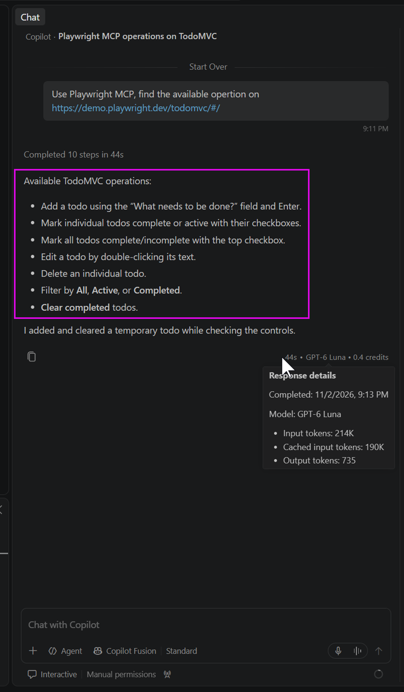{.center .lightbox}

不需要告訴 AI 代理具體的 DOM 操作細節，AI 代理會根據 Playwright MCP 提供的結構化快照，自行探索網站並列出網站可操作的邏輯功能

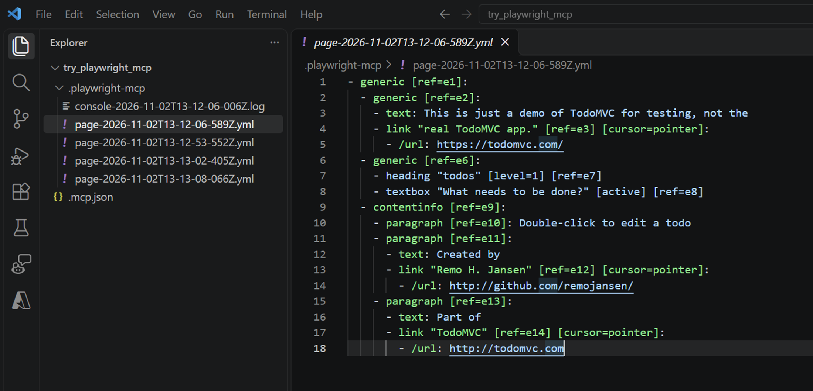{.center .lightbox}

## GitHub Copilot + Playwright MCP<br/>產生E2E測試案例{.scrollable}

\

* 指揮 GitHub Copilot 透過 Playwright MCP 提供的結構化快照，自動生成對應的 E2E 測試案例，涵蓋網站的各種操作場景。
* 開發者無需手動編寫繁瑣的 DOM 操作程式碼，只需關注測試邏輯與驗證條件，提升測試效率與可靠性。


1. 將測試專案 [Demo_Playwright](https://github.com/isak-ghcopilot-workshop/Demo_Playwright/tree/todolist_src) 的 `todolist_src` git clone 或下載 zip 到本機硬碟
2. 用 VSCode 開啟 `todolist_src` 專案
3. 確認系統已安裝 .NET 10 SDK, Node.js LTS 版本
4. 在 **src/** 目錄下建立一個 "E2ETest" 目錄
5. 在 **src/BlazorApp** 目錄下執行 `dotnet watch`，此時應會執行 Blazor Web App，並自動開啟瀏覽器網址：http://localhost:5241/
   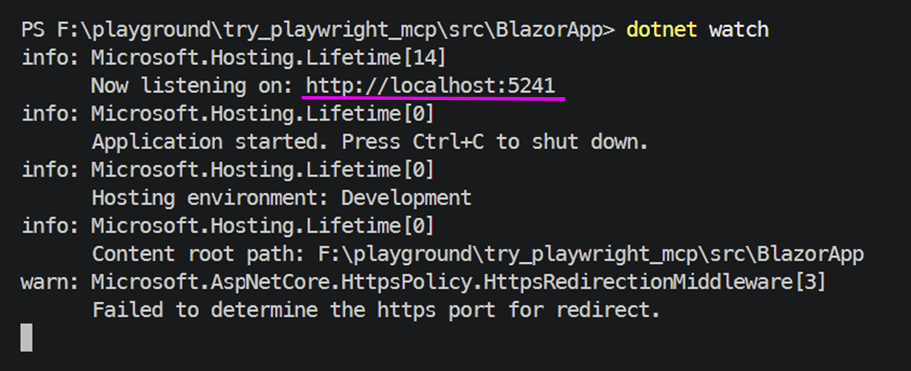{.center .lightbox}
6. 將剛剛建立的 E2ETest 目錄用滑鼠拖曳到 VSCode Agent Chat View，並使用此 Prompt 來指揮 GitHub Copilot 生成 E2E 測試案例：
   
   ````text
   ```
    - You are a playwright test generator.
    - You are given a scenario and you need to generate a playwright test for it.
    - DO NOT generate test code based on the scenario alone. 
    - DO run steps one by one using the tools provided by the Playwright MCP.
    - Only after all steps are completed, emit a Playwright TypeScript test that uses @playwright/test based on message history
    - Save generated test file in the tests directory
    - Execute the test file and iterate until the test passes
   ```
   Generate playwright test project in E2ETest for http://localhost:5241/
   ````
   
   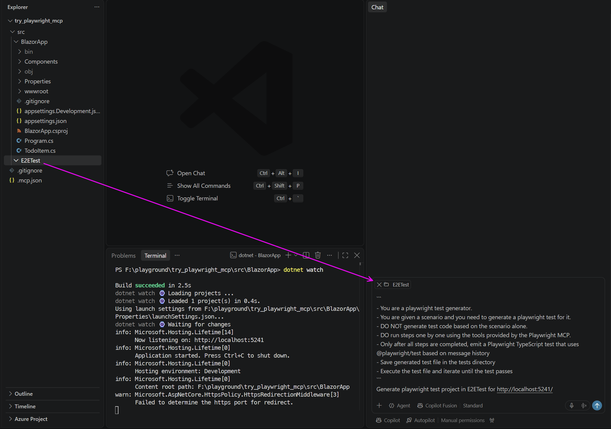{.center .lightbox}
7. GitHub Copilot 會呼叫 Playwright MCP 開始『探索網站』：
   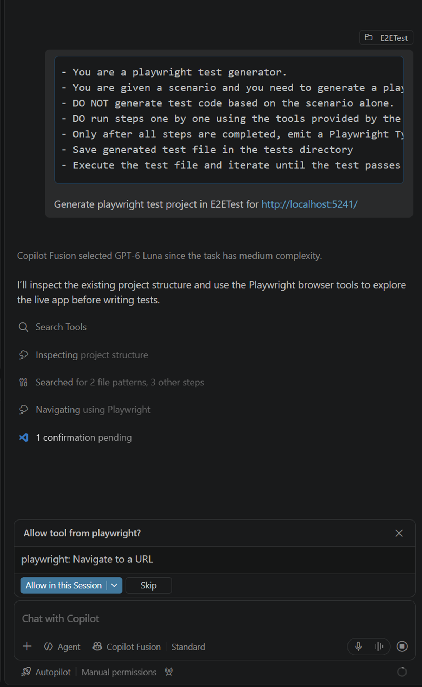{.center .lightbox}
   允許它執行所有跟 Playwright 相關的 tool 呼叫，此時會自動開啟另一個瀏覽器並開始自動探索網站。
   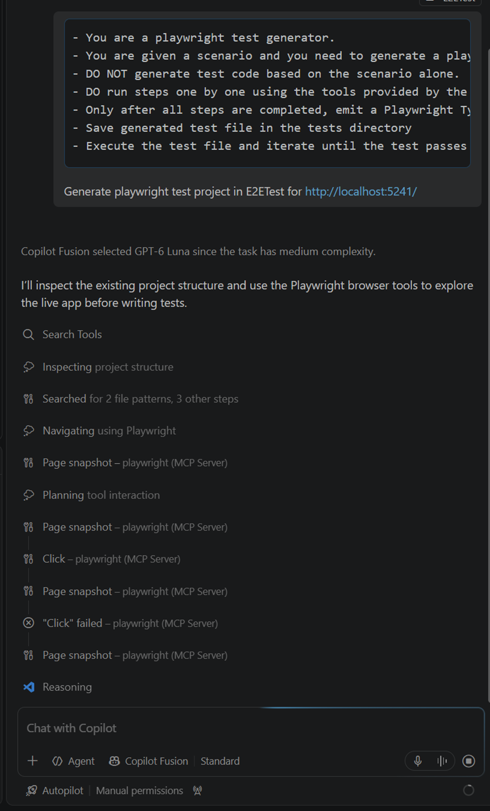{.center .lightbox}
8. 執行到最後，GitHub Copilot 會根據 Playwright MCP 提供的結構化快照，自動生成 E2E 測試案例：
   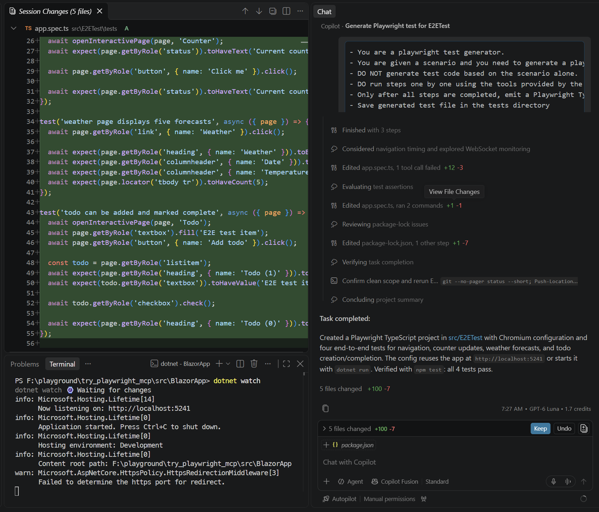{.center .lightbox}
9. 此時應該也可以在 src/E2ETest 目錄下執行 `npm test` 來運行生成的 E2E 測試案例。
   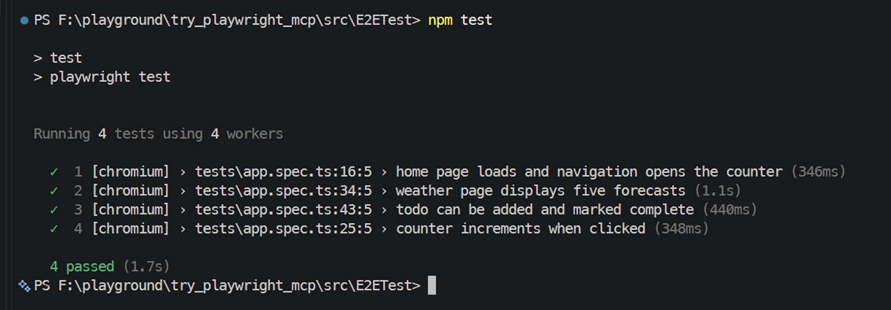{.center .lightbox}

:::{.callout-important}
產生的測試案例雖然可以跑，但可能需要根據實際情況進行調整與修正，AI 生成的程式碼可能不會測試到網站的所有功能或預期邏輯。
:::

# Playwright CLI 與 GitHub Copilot<br/>整合

## Playwright CLI

[Playwright CLI](https://playwright.dev/agent-cli/introduction){target="_blank"} 是 Playwright 提供的命令列工具，用於自動化瀏覽器操作。透過 Playwright CLI，開發者可以編寫、執行和調試端對端測試腳本，支援多種瀏覽器環境。

Playwright CLI 為 Apache-2.0 授權的開源軟體：<br/>[https://github.com/microsoft/playwright-cli](https://github.com/microsoft/playwright-cli){target="_blank"}

## Why another CLI tool for Playwright?

\

* Playwright MCP 可做的任務，Playwright CLI 也能完成，但 CLI 消耗的 AI Token 較少，因此在某些情境下使用 CLI 會更高效。
   
* Playwright CLI 可配合 Chrome 的 DevTools 進行已在運作中瀏覽器的操作與調試，因此可在測試案例上跳過某些不需/無法寫自動測試的認證步驟、使用遠端瀏覽器進行測試。

::: {.callout-note}
CLI 將一些隱含的知識和操作背景藏在指令列實際執行的動作中，因此可以減少AI Agent 需要理解的上下文資訊。
:::

## Playwright CLI + Agent Skill

* Playwright CLI 本身帶有[內建的 Agent Skill](https://github.com/microsoft/playwright-cli/tree/main/skills/playwright-cli){target="_blank"}，結合 GitHub Copilot 呼叫可以實現更高效/可客製化的自動化測試流程，利用 AI 來輔助生成、調試和修正測試案例。

```{=html}
<pre>
GHCopilot
   ↓
Agent Skill
   ↓
Playwright CLI
   ↓
Browser
</pre>
```

## 選用 Playwright CLI 或 Playwright MCP 的考量

[Playwright CLI vs MCP](https://playwright.dev/agent-cli/introduction#playwright-cli-vs-mcp){target="_blank"}

| | Playwright CLI | MCP |
|---|---|---|
| Best for | Coding agents (Claude Code, Copilot) working with large codebases | Specialized agentic loops, exploratory automation |
| How it works | Agent runs shell commands | LLM calls MCP tools with structured parameters |
| Token cost | Lower — concise CLI output, skills loaded on demand | Higher — tool schemas + snapshots in context |
| Default mode | Headless | Headed |
| WebMCP support | Faster | Slower |
| Setup | `npm install -g @playwright/cli` | JSON config in MCP client |

## Lab13: 使用 Playwright CLI 與 GitHub Copilot 自己探索網站{.scrollable}

1. 安裝 Playwright CLI：<br/>
   確保已經安裝 Node.js，然後在終端中執行以下命令安裝 Playwright CLI。
   
    ```sh
    npm install -g @playwright/cli@latest
    ```
2. 初始化 Playwright：<br/>
   用 VSCodoe 開啟一個空白工作目錄，在終端中執行以下命令初始化 Playwright-CLI，這會安裝 Playwright-CLI 的 Agent Skill 到此工作目錄。
   
    ```sh
    playwright-cli install --skills=agents
    ```
   :::{.callout-note}
   假如你碰到類似下圖錯誤，請先執行 `nvm firewall trust module playwright-cli` 和 `nvm reshim` 後再執行 Playwright CLI 的初始化命令。
   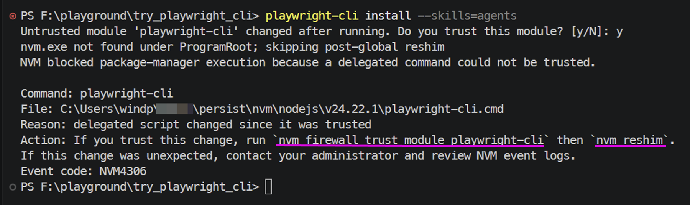{.center .lightbox}
   :::
3. Playwright-CLI 的 Agent Skill 已安裝完成，可在根目錄的 .agents 目錄下看到相關配置與技能檔案。
   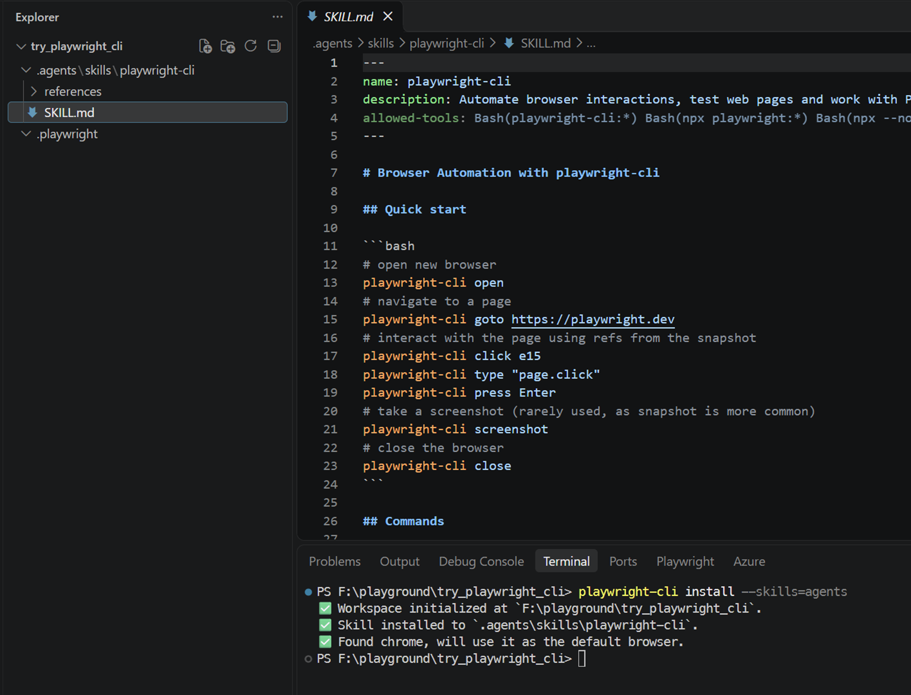{.center .lightbox}
4. 此時打開 VSCode Agent Chat View，應該會有 Playwright CLI 的 Agent Skill 可供使用。
   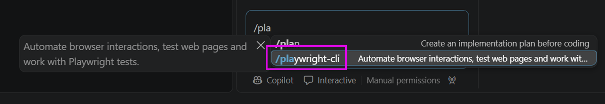{.center .lightbox}
5. 現在可以開始使用 Playwright CLI 的 Agent Skill 來探索網站，透過以下 Prompt ：
   ```text
   /playwright-cli find the available operation on https://demo.playwright.dev/todomvc/#/
   ```
   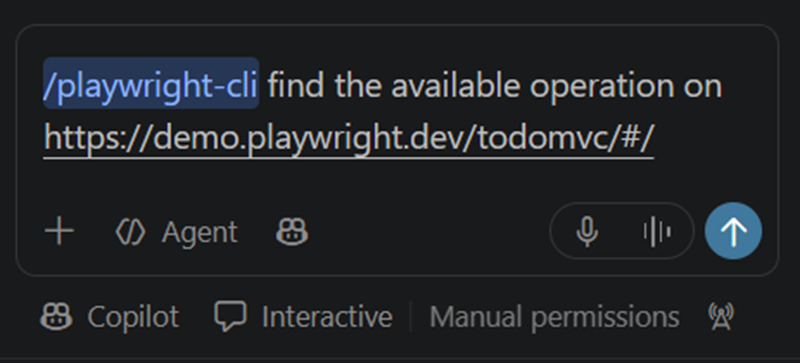{.center .lightbox}
6. 如詢問是否要允許 Playwright CLI 的 tool 呼叫，選擇允許，等執行完畢後，應該可觀察到類似之前使用 Playwrright MCP 的操作結果。
   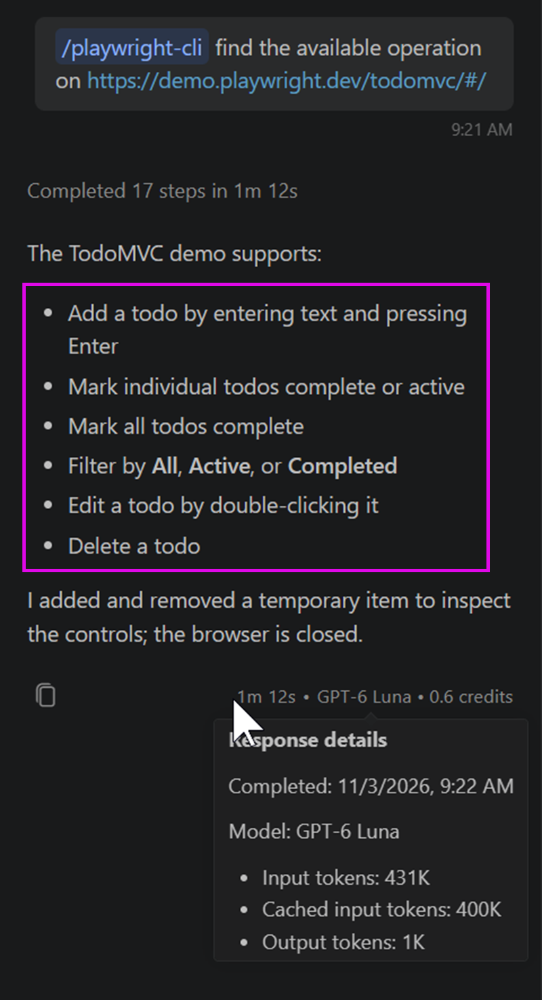{.center .lightbox}

## 直接使用 Playwright CLI

Playwright CLI 也可以直接使用，而不透過 Agent Skill。可以在終端中執行 Playwright CLI 的命令來操作瀏覽器，例如：


```sh
playwright-cli open https://demo.playwright.dev/todomvc/ --headed
playwright-cli type "Buy groceries"
playwright-cli press Enter
playwright-cli type "Water flowers"
playwright-cli press Enter
playwright-cli check e21
playwright-cli check e35
playwright-cli screenshot
```


所以如果有那種確定不變型的操作需求，可以直接使用 Playwright CLI 來執行，而不需要透過 Agent Skill 和 AI 代理來跑。

# 使用 GHCopilot 產生 Playwright E2E Tests case

## 從 Requirement 到 Test

假如一開始就有明確的需求，我們可以先將需求轉化為測試案例，再使用 Playwright CLI 或 Agent Skill 來實現自動化測試：

\

```{=html}
<pre>
Requirement
 ↓
Copilot
 ↓
Test Scenarios
 ↓
Playwright Tests
 ↓
Execution
</pre>
```

\

這樣會比直接叫 AI 代理 `Write Playwright Tests` 的效果更好，因為需求、測試場景與測試案例的轉化過程是可控且可驗證的，給予 AI 足夠的上下文，能確保生成的測試更符合實際需求。

## 讓 AI 代理先生成網站敘述再產生測試


:::: {.columns}
::: {.column}
Bad:

```text
Write Playwright tests
```
:::
::: {.column}
Good:
```text
Analyze the user workflow first.

Identify:
1. happy paths
2. validation errors
3. edge cases
4. navigation behavior

Then generate Playwright E2E tests.
```
:::
::::

> Don't guess the UI. Let the agent inspect the UI first.

## 讓 AI 代理也讀取網站原始碼再產生測試

在生成測試之前，讓 AI 代理先讀取網站的原始碼<br/>(如果網站專案是遵循SDD開發的話更好)，能夠更準確地理解網站的結構與元素，從而生成更可靠的 Playwright 測試案例。

\

```{=html}
<pre>
  Source Code 
      +
Requirements + Browser Exploration
      ↓
 GitHub Copilot
      ↓
Playwright Tests
</pre>
```


# E2E Test Debug、Diagnose、Fix 與 Retest

## E2E Test Debug {.scrollable}

Playwright 提供 VSCode 的擴充套件：[Playwright Test for VSCode](https://marketplace.visualstudio.com/items?itemName=ms-playwright.playwright){target="_blank"}

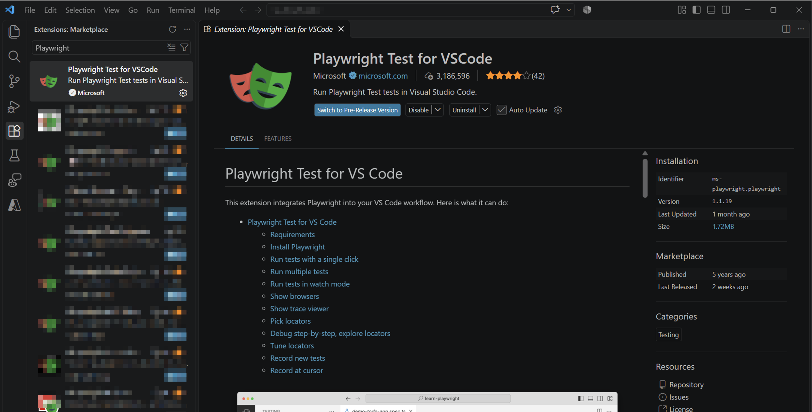{.center .lightbox}

安裝後，除了可以在 VSCode 中以GUI執行 Playwright 測試:

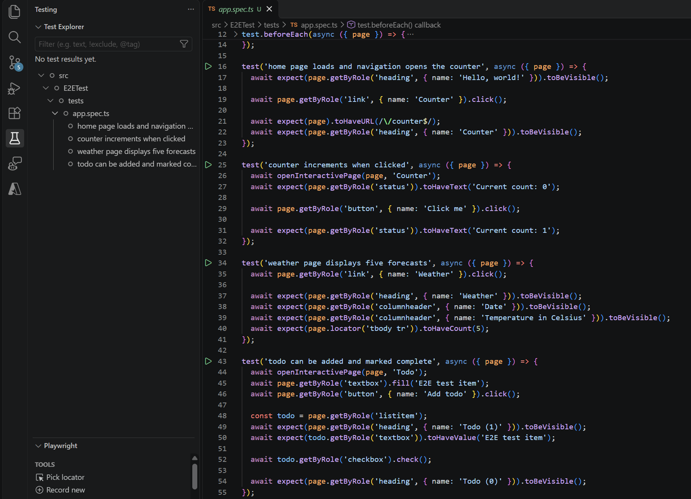{.center .lightbox}

Playwright 測試專案在 VSCode 還可設定中斷點，在測試執行過程中進行偵錯與診斷：

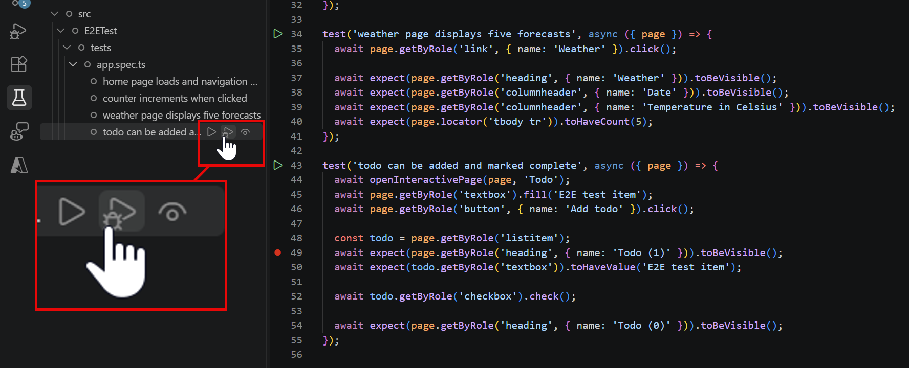{.center .lightbox}

所以可在執行途中暫停測試，檢查瀏覽器狀態與元素，進行偵錯：
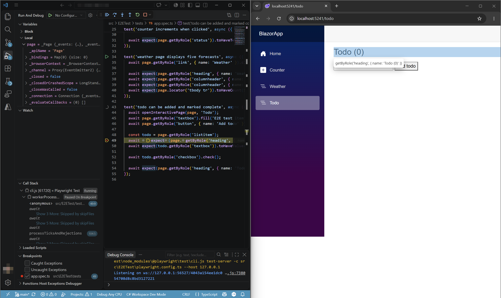{.center .lightbox}

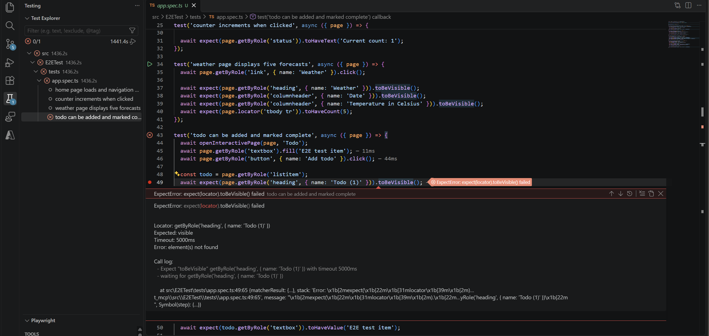{.center .lightbox}

官方文件：[https://playwright.dev/docs/getting-started-vscode](https://playwright.dev/docs/getting-started-vscode){target="_blank"}

## Diagnose, Fix, Retest {.scrollable}

\

Agentic E2E Test 有價值的不是純粹產生測試，而是在測試失敗時，能夠協助診斷問題，提供修復建議，並在修復後重新執行測試，形成完整的測試迭代流程。

\

```{=html}
<pre>
Generate
 ↓
Run
 ↓
Fail
 ↓
Diagnose
 ↓
Fix
 ↓
Retest
</pre>
```

::: {.callout-tip}
Test Failure 不只是 Error，而是『Agent Observation』
:::

\

### Self-Correction Loop


```{=html}
<pre>
Run Test
   ↓
Observe Failure
   ↓
Diagnose
   ↓
Propose Fix
   ↓
Apply Fix
   ↓
Retest
   │
   └──── Failure ────┐
                     ↓
                  Diagnose

</pre>
```

# Agent Skills + MCP + CLI 的 Agentic Testing Workflow

## Agentic Testing Workflow

Playwright-CLI 的 Agent Skill，除了直接拿來使用之外，也可配合我們自己撰寫的 Agent Skills 進行更靈活的自動化測試流程。

```{=html}
<pre>
                 GHCopilot
                     │
             ┌───────┴───────┐
             │               │
        Agent Skills         MCP
             │               │
      Testing Knowledge    Browser
             │               │
             └───────┬───────┘
                     │
                Playwright CLI
                     │
                     ▼
             Playwright Tests
                     │
                     ▼
              Blazor WASM App
</pre>
```

## 自製的 Testing Skill 包含什麼？{.scrollable}

首先定義我們自製的 Testing Agent Skill 檔案架構如下：

[Skill 原始檔](https://github.com/isak-ghcopilot-workshop/Custom-Playwright-TestingSkill/tree/main/.github/skills/playwright-testing){target="_blank"}

```{.text code-line-numbers="false"}
.github/
└── skills/
    └── playwright-testing/
        ├── SKILL.md
        ├── test-strategy.md
        ├── debugging.md
        └── conventions.md
```
\

Skill 定義:

* Test conventions
* Naming
* Locator strategy
* Debugging workflow
* Screenshot policy
* Retry policy
* Reporting

\

```{=html}
<pre>
SKILL.md
│
│   Agentic Testing Workflow
│   Explore → Plan → Implement → Run
│                    ↓
│              Diagnose → Fix → Retest
│
├── test-strategy.md
│     What should we test?
│
├── conventions.md
│     How should we write tests?
│
└── debugging.md
      How should we diagnose failures?  
</pre>
```

\

AI 代理在執行時進行的階段流程如下：

```{=html}
<pre>
Feature
 ↓
Explore
 ↓
Discover Test Scenarios
 ↓
Generate Tests
 ↓
Run Tests
 ↓
Diagnose
 ↓
Fix
 ↓
Retest
 ↓
Report
</pre>
```

## Agentic Testing Core Concepts

\

* Browser 是 Agent 的「眼睛」
* Playwright CLI 是 Agent 的「手」
* Skill 是 Agent 的「經驗」

## Agentic E2E Testing Workflow 目標

\

從『用 Copilot 寫 Playwright Test』 升級成

\

> 『能 Explore、Test、Diagnose、Fix、Retest 的<br/>Agentic E2E Testing Workflow』


```{=html}
<pre>
           GitHub Copilot
               Agent 
                 │
      ┌──────────┼──────────┐
      │          │          │
    Skills      MCP        CLI
   Knowledge   Observe     Act
      │          │          │
      └──────────┼──────────┘
                 ↓
          Agentic Testing
                 ↓
 Explore → Test → Fail → Diagnose
                 ↑          │
                 └── Fix ←──┘
</pre>
```


# Hands-on: Blazor WebAssembly E2E Tesing Challenge & QA


## Lab14: Blazor WebAssembly E2E Testing 

[Lab14 操作步驟及範例原始碼](){target="_blank"}

## 結論

* 使用 GitHub Copilot Agent + Playwright 進行 E2E 測試
* Agentic Testing Workflow 的完整流程，包括探索測試場景、生成測試、診斷失敗、修復問題以及重新測試。
* 透過自製的 Testing Skill，我們能夠提升測試的自動化程度與可靠性，並建立一致的測試規範與流程。