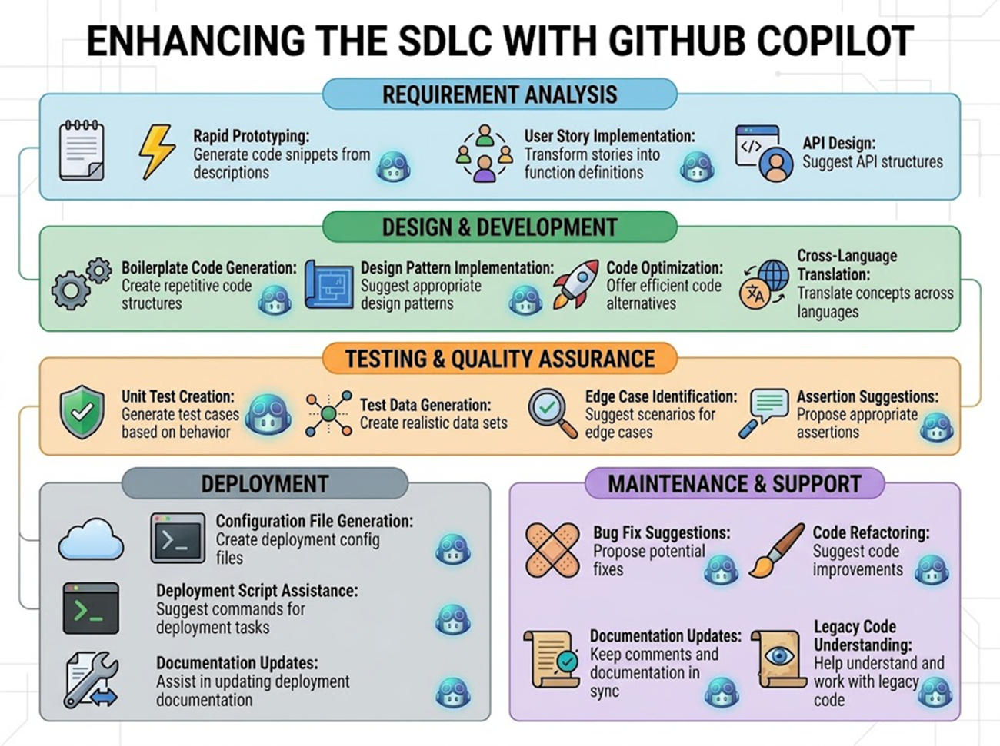
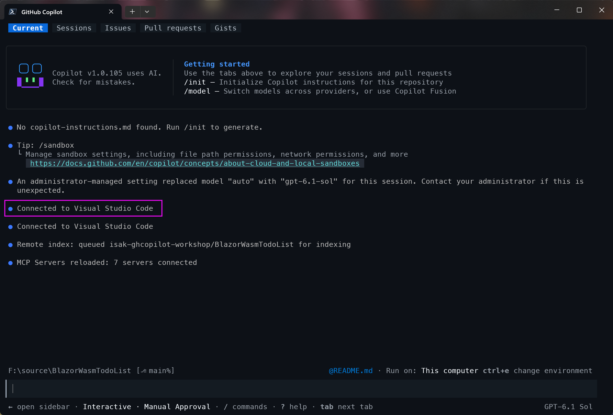
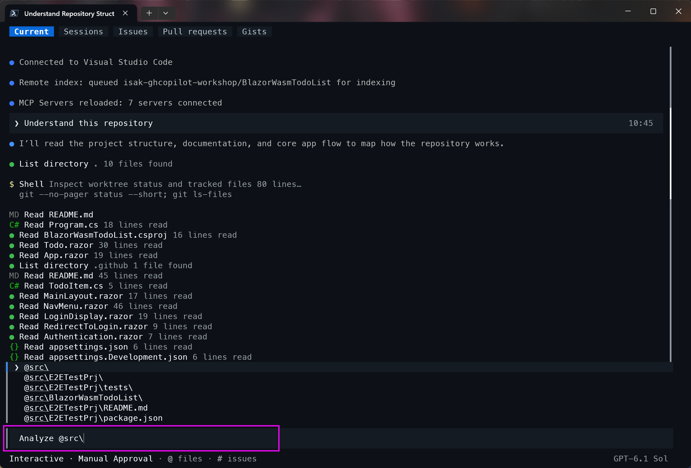
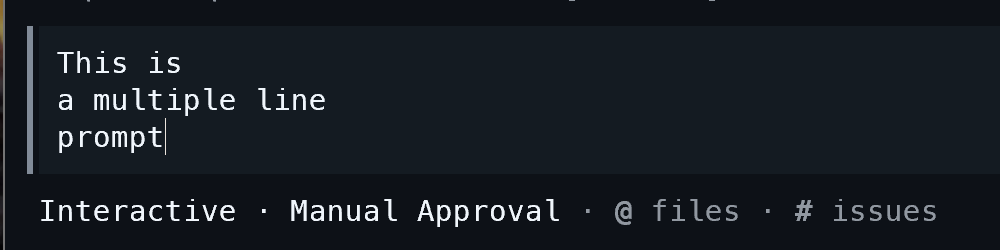
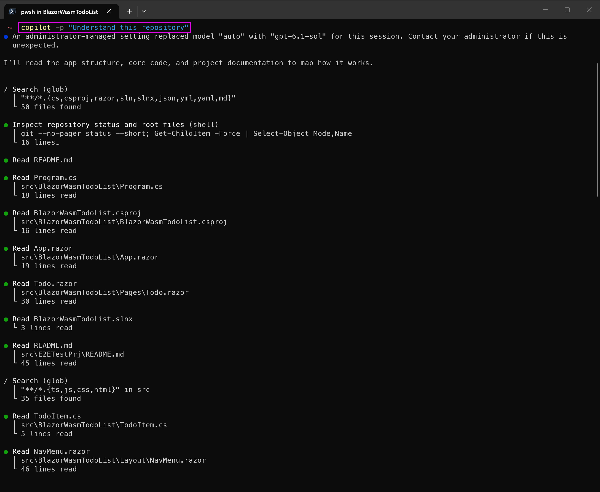
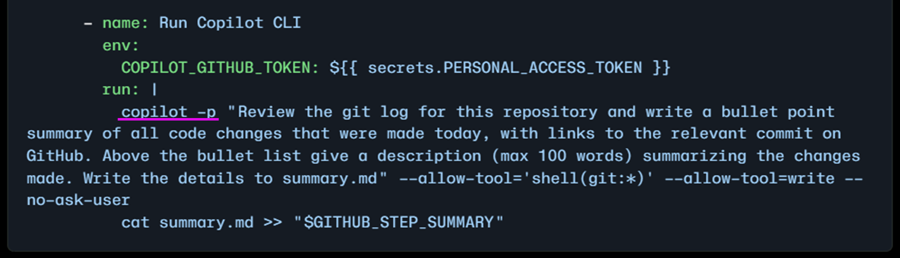
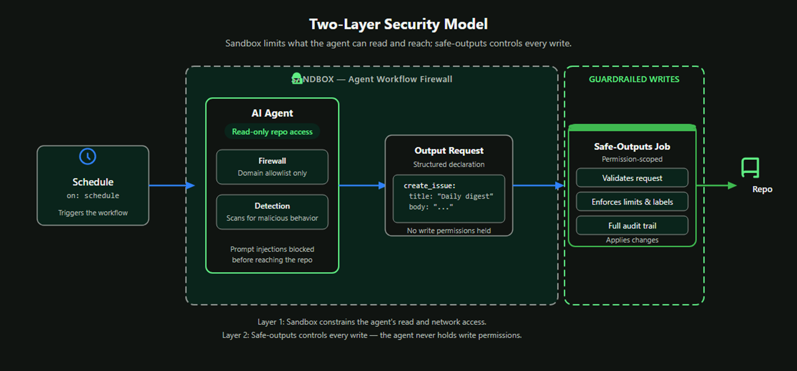
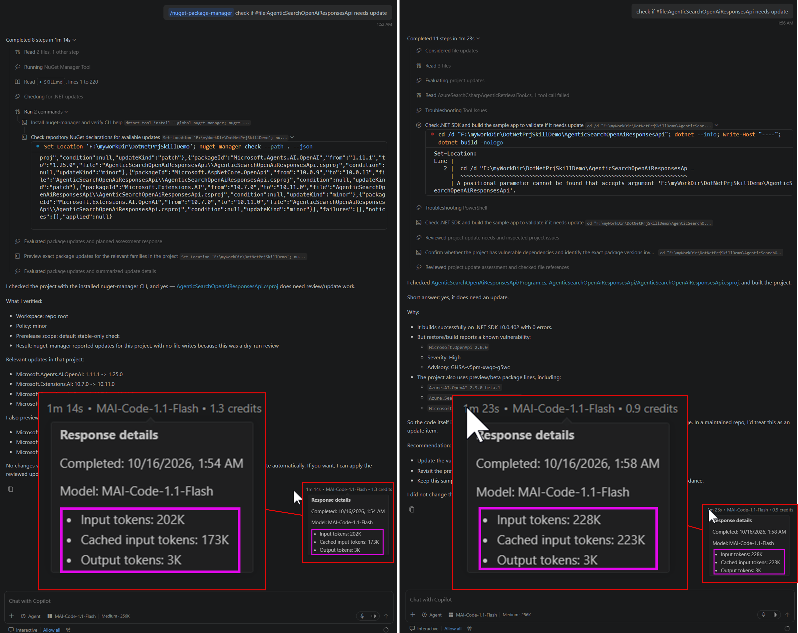
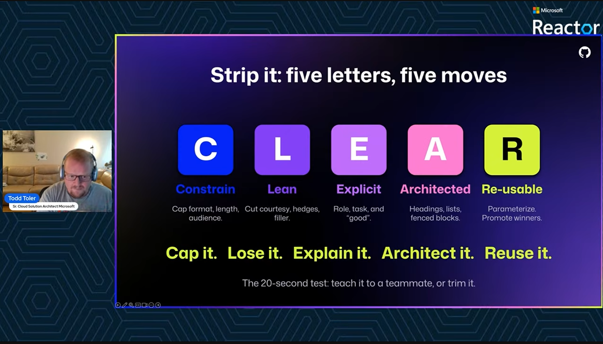

# Agenda

* Agentic Coding Recap
* GitHub Copilot CLI Fundamentals
* CLI Agentic Coding Techniques
* Agent Skill Engineering: Good Skill vs Bad Skill
* Context & Token Engineering
* Agentic Coding Challenge & QA

# Agentic Coding Recap

## GitHub Copilot Agentic Coding {.scrollable}

:::: {.columns}
::: {.column}
```{=html}
<pre>
  Developer
   │
   ▼
Prompt
   │
   ├── Custom Instructions
   │
   ├── AGENTS.md
   │
   ├── Agent Skills
   │
   ├── Custom Agent
   │
   ├── MCP
   │
   └── Agent Plugin
   │
   ▼
GitHub Copilot
   │
   ├── VS Code
   │
   ├── Copilot CLI
   │
   └── Coding Agent
   │
   ▼
Code / Test / Build / Git / GitHub
</pre>
```
:::
::: {.column}

{.center .lightbox}

現在的趨勢是越來越不需要人類主動打開IDE手動操作、手動打程式碼，而是由 AI 代理自動完成開發流程，但人類仍然需要負責設計、監督與驗證，負擔最終的責任。

:::
::::

# GitHub Copilot CLI Fundamentals

## GitHub Copilot CLI Overview {.scrollable}

GitHub Copilot CLI 是一個命令列工具，允許開發者在終端中使用 GitHub Copilot。它可以幫助開發者自動生成程式碼片段、測試、以及其他開發相關的任務，且可與 Agentic Coding 流程整合，提升開發效率。

[GitHub 原始碼](https://github.com/github/copilot-cli){target="_blank"}

  * [GitHub Copilot CLI 使用說明](https://docs.github.com/en/copilot/concepts/copilot-surfaces/copilot-cli){target="_blank"}
  * [GitHub Copilot CLI how-tos](https://docs.github.com/en/copilot/how-tos/copilot-cli){target="_blank"}


:::{.callout-tip}
* 在Windows環境建議搭配 [Windows Terminal](https://aka.ms/terminal){target="_blank"} 使用
* 安裝時請順便裝 GitHub CLI ([https://cli.github.com/](https://cli.github.com/){target="_blank"} )，使用者登入授權會比較方便
:::

* 獨立於VSCode等 IDE 工具的單獨 GH Copilot 命令列工具
* 適用於完全不需/不想看程式碼的 AI Coding場合
   
   ```
   Prompt → Explore → Plan → Execute → Verify
   ```

* 或是用於 CI/CD 等沒有 IDE 的軟體專案工作場合

## GitHub Copilot CLI 優點 {.scrollable}

* 可持續使用，GH Copilot CLI 會[自動壓縮 Agent Session memory](https://docs.github.com/en/copilot/how-tos/copilot-cli/cli-best-practices#3-leverage-infinite-sessions){target="_blank"}
* 用自然語言操作 Terminal ，省得記憶一堆指令\
   (等價交換的代價是燒AI token)
* 不需要開啟IDE就可命令Coding Agent改程式\
  (不過若同專案在VSCode打開時會偵測到並即時sync)\
  {.center .lightbox}
* 與 GitHub.com 網站服務深度整合，進行DevOps自動化任務\
  VS Code Copilot 幫你寫程式，\
  GitHub Copilot CLI 幫你完成整個開發工作流程。

## GitHub Copilot CLI 使用方式 {.scrollable}

* 在終端中使用 `copilot` 指令進入 GitHub Copilot CLI 環境
  {.center .lightbox}
  
  :::{.callout-tip}
  要輸入多行文字，使用 `Ctrl+J` 換行
  
  ::: 
   
* 使用 `copilot -p "輸入的Prompt"` 執行單次的 AI 代理操作
   {.center .lightbox}

## GitHub Copilot CLI 幾個常用的 『slash(/)』指令

[GitHub Copilot CLI 指令總覽](https://docs.github.com/en/copilot/reference/copilot-cli-reference/cli-command-reference){target="_blank"}

* `/model` : 選擇使用的 LLM model
* `/init` : 建立/更新目錄所在專案層級 GitHub Copilot 之 Global Custom Instruction 檔案
* `/plan` : 切換到 GitHub Copilot 不會動到任何檔案的 Plan 模式
* `/resume` : 恢復先前退出時的Chat session
* `/agent` : 選取/使用 GitHub Copilot 的 Custom Agent
* `/skill` & `/skills` : 管理 GitHub Copilot 的 Agent Skills
* `/mcp` : 管理 GitHub Copilot 的 MCP Server 資源
* `/plugin` : 管理 GitHub Copilot 的 Agent Plugin 相關資源
* `/exit` : 退出 GitHub Copilot CLI 環境
* `/help` : 顯示所有可用指令及其說明

# CLI Agentic Coding Techniques

## 先 Explore，不要直接叫它改

讓 AI 代理先探索專案，而不是直接修改程式碼
\
\

```text
Fix this project.
```

::: {.r-stack}

\
⬇️
\
\

:::

```text
Explore this repository.

Identify:
1. architecture
2. major components
3. dependencies
4. potential risks

Do not modify any files.
```

## Planning before Coding {.scrollable}

在開始修改程式碼之前，先讓 AI 代理進行規劃，確認專案架構、主要元件、依賴關係以及潛在風險，人類確認後再指揮 AI 代理進行修改，由避免盲目修改造成問題。

1️⃣

```text
Analyze the requirement.

Create an implementation plan.

For each step identify:
- files affected
- implementation approach
- risks
- tests required

Do not modify the code yet.
```

2️⃣

```text
Implement step 1 only.
Do not proceed to step 2 until step 1 is completed and verified.
```

::: {.callout-tip}
Copilot CLI 也特別提供 /plan，強調先進行 planning，再進入 execution。
:::

## Verification Loop

如果要讓 GitHub Copilot CLI 在修改程式碼後進行驗證，應該建立一個 Verification Loop，確保每一步修改都經過檢查與確認，避免錯誤累積。

\

::: {.border}
1. AI 代理提出修改計畫
2. 人類審查計畫，確認無誤
3. AI 代理執行修改
4. 使用測試案例或其他驗證工具驗證修改結果
5. 若有問題，回到步驟 1 重新規劃
:::

## GitHub Action 整合 GitHub Copilot CLI {.scrollable}

在一些很簡單CI/CD場合，可使用 GH Copilot 的 –p 參數來執行一些Prompt讓 Coding Agent 做事：

[官方說明](https://docs.github.com/en/copilot/how-tos/copilot-cli/automate-copilot-cli/automate-with-actions){target="_blank"}

{.center .lightbox}

::: {.callout-important}
* 這會消耗設定 PAT Token 的 GitHub Copilot 個人/組織帳號所屬的 AI Credit 使用額度
* 建議需要比較長時間跑或是去跟外部資源/MCP整合的還是使用 [Cloud Agent](https://docs.github.com/en/copilot/how-tos/use-copilot-agents/cloud-agent/use-cloud-agent-on-github){target="_blank"} / [GitHub Agent Workflow](https://docs.github.com/en/copilot/how-tos/github-agentic-workflows){target="_blank"}，有較完善的Sandbox環境讓 AI 代理可安全執行任務。
   {.center .lightbox}
:::

其他將 GH Copilot CLI 整合 DevOps 流程實例，可參考此 [部落格文章](https://dev.to/pwd9000/github-copilot-cli-a-devops-engineers-practical-guide-to-ai-powered-terminal-automation-1jh0){target="_blank"}。

## GitHub Copilot CLI Recap

\
從單純的 Console 使用，Agentic Coding，進階到 Agentic SDLC 的流程
\
\

::: {.r-stack}
```{.text code-line-numbers="1,4,13"}
  GitHub Copilot CLI
        │
        ▼
   Agentic Coding
        │
        ▼
    Agent Skills
        │
        ▼
  Reusable Workflow
        │
        ▼
   Agentic SDLC
```
:::

# Agent Skill Engineering:<br/>Good Skill vs Bad Skill

## Agent Skill Engineering

\
\
\

::: {.r-stack}
> Agent Skill ≈ Context Engineering 
:::

\
\

::: {.r-stack}
從「會寫 Skill」進階到「會設計好的 Skill」
:::

## Bad Skill vs Good Skill

\

### ❌ Bad Skill

```markdown
---
name: dotnet-api
description: Create APIs.
---

Create an API.

Follow best practices.

Add tests.

Make sure the code is good.
```
\
通常人類看了覺得很『模糊』，不知道該怎麼做的，AI 也會感到困惑。

## What Makes a Good Agent Skill?
\

### 6 個評估面向

\

面向 | 要問的問題
---|---
🎯 Discoverability |	Agent 知不知道什麼時候該用它？
📐 Scope |	Skill 的責任範圍是否清楚？
🧭 Instructions |	執行步驟是否明確、可操作？
📦 Context |	有沒有只提供真正需要的 context？
🔁 Repeatability |	同類任務重跑，結果是否穩定？
✅ Verifiability	| Agent 做完之後，知道怎麼驗證嗎？


## Scope & Trigger Design

**"When to Use"** AND/OR **"When _NOT_ to Use"**

```{=html}
<pre>
  Good Skill

        What I DO
            │
            ▼
      ┌─────────────┐
      │ Skill Scope │
      └─────────────┘
            ▲
            │
      What I DON'T DO
</pre>
```
\

::::{.columns}
::: {.column}
``` {.text code-line-numbers="false"}
## When to use

Use this skill when:

- creating REST API endpoints
- modifying existing endpoints
- adding API request/response models
- adding API tests
```
:::
::: {.column}
``` {.text code-line-numbers="false"}
## Do not use

Do not use this skill for:

- UI development
- database migration
- infrastructure provisioning
- general code review
```
:::
::::

:::{.callout-tip}
降低 Skill 之間的 Scope Overlap，避免 AI 代理同時載入多個 Skill，造成 context 混亂。
:::

## Progressive Disclosure

Agent 只在需要時載入所需 context；Skill 由 SKILL.md 搭配 scripts/、references/、assets(examples)/ 等內容組成

\

:::: {.columns}
::: {.column}

❌ Everything in SKILL.md

```
SKILL.md

Architecture
Coding Standard
Testing Standards
API Guideline
Security Guideline
Examples
Troubleshooting
Templates
...
```

最後變成一大包
:::
::: {.column}
✅ Progressive Skill

```
dotnet-api/

├── SKILL.md
│
├── references/
│   ├── architecture.md
│   ├── api-guidelines.md
│   └── testing.md
│
├── examples/
│   └── product-api.md
│
└── scripts/
    └── validate.sh
```

:::
::::

\
Microsoft Agent Framework [**four-stage progressive disclosure pattern**](https://learn.microsoft.com/agent-framework/agents/skills?pivots=programming-language-csharp#progressive-disclosure){target="_blank"}

## Teach Procedures, not Knowledge Dumps

\
\

:::: {.columns}
::: {.column}

❌ Knowledge Dump

``` {.text code-line-numbers="false"}
Our application uses Clean Architecture.

Domain contains entities.

Application contains business logic.

Infrastructure contains database implementation.

API contains controllers.
```

這些只是「_知識_」。

:::
::: {.column}

✅ Procedural Guidance

``` {.text code-line-numbers="false"}
## Implementing an API

1. Inspect existing endpoints.

2. Identify the existing architectural pattern.

3. Identify the Domain and Application components affected by the feature.

4. Implement the smallest required change.

5. Add tests following existing test conventions.

6. Build the solution.

7. Run affected tests.

8. Review the diff before completing the task.
```
:::
::::

:::{.callout-tip}
A good Skill doesn't just tell the agent what it knows. It tells the agent **how** to work.
:::

## Verification Strategy

\

很多 Agnet SKill 最大的問題是 `Do something `\
但是沒有：`How do I know I'm done?`

\

``` {.text code-line-numbers="false"}
## Validation

Before completing the task:

1. Build the solution.
2. Run affected unit tests.
3. Verify no unrelated files were modified.
4. Review the implementation against the requirements.
5. Report any unresolved issues.
```

## 

\
Agent Skill 被 LLM/Agent 的使用流程應該要是：

\

::: {.r-stack}
::: {style="width: 50%;"} 
```{=html}
<pre>
Understand
    ↓
  Plan
    ↓
 Execute
    ↓
 Validate
    ↓
  Review
    ↓
   Done
</pre>
```
:::
:::

## Evaluation

* Agnet Skill 還有一個隱藏面向上述沒有提及：AI token 使用成本。

* 這牽扯到使用的 Harness 框架設計 與 Agent選用的大語言模型選型，都會影響 AI token 的使用成本。

{target="_blank"}](./pics/Copilot_Agent.png){.center .lightbox}

## {.scrollable}

::: {.callout-important}
也不是說 AI token 消耗越少的 Agent Skill 越好，因為很有可能消耗少但執行效果差，導致 AI 代理判斷任務完成度沒達到而looping重複執行，反而增加總成本。
:::

{target="_blank"}](./pics/Copilot_Agent-loop.png){.center .lightbox}

## 如何進行 Agent Skill 評估 {.scrollable}

要進行正規 Agent Skill 評估，概念上的進行步驟：

[https://agentskills.io/skill-creation/evaluating-skills](https://agentskills.io/skill-creation/evaluating-skills){target="_blank"}

::: {.border}
1. 準備測試材料
2. 限定測試環境
3. 測試環境 AI 代理執行 Agent Skill
4. 收集執行結果
5. 評估結果是否符合預期
6. 記錄評估過程與結論
:::

得先蒐集資料，包含測試材料、測試環境設定以及相關的 AI 代理配置，才能進行後續的評估步驟。

然後使用例如 [Microsoft Foundry Evaluation Service](https://learn.microsoft.com/azure/foundry/concepts/observability){target="_blank"} 結合一些 [自行撰寫的評估工具](https://learn.microsoft.com/agent-framework/agents/evaluation?pivots=programming-language-csharp){target="_blank"} 來進行 Agent Skill 的評估。

* NET 開發團隊的範例: [https://github.com/dotnet/skills/tree/main/eng/skill-validator/src](https://github.com/dotnet/skills/tree/main/eng/skill-validator/src){target="_blank"}
* 第三方如 [Nvidia 的 SkillEvaluator](https://docs.nvidia.com/skills/skillevaluator){target="_blank"}

## Agent Skill Recap {.scrollable}

Agent Skill Review Checklist

 | # | 檢驗項目
 |---|---|
 | 1 | Purpose 是否清楚？ |
 | 2 | Trigger / Description 是否明確？ |
 | 3 | Scope 是否夠小、夠聚焦？ |
 | 4 | Instructions 是否 actionable？ |
 | 5 | 是否避免塞入不必要 context？ |
 | 6 | References / Scripts 是否合理拆分？ |
 | 7 | 是否有 validation？ |
 | 8 | 是否有測試 Trigger / Non-trigger scenarios？ |

> A good prompt gets a good answer once.

> A good skill creates a repeatable engineering behavior.

\

第三方相關工具/資源：

* [Nvidia SkillSpector](https://docs.nvidia.com/skills/scanning-agent-skills){target="_blank"}
* [Anthropic Skill Creator](https://copilot-academy.github.io/workshops/copilot-customization/agent_skills_developer_guide#4-walkthrough-2-using-the-skill-creator){target="_blank"}
* [Agent Skills File Guidelines](https://github.com/github/awesome-copilot/blob/main/instructions/agent-skills.instructions.md){target="_blank"}
* [自製的 Portable VSCode 隔離環境](https://github.com/windperson/Win-VSCode-Portable){target="_blank"}
* [skillops-studio](https://hackmd.io/@HWDC/2026/%2FIgPBdg-8S5WlcpD9IaP1-A){target="_blank"}

# Context & Token Engineering

## Context ≠ 越多越好 {.scrollable}

\


```{=html}
<pre>
  Relevant Context
         +
  Clear Instructions
         +
  Required Tools
         ↓
  Better Agent Behavior
</pre>
```

通常越大 Context 的模型越貴

```text
"Read the whole repository"
```

::: {.r-stack}

\
⬇️
\
\

:::


```text
Explore the repository structure first.

Identify files relevant to this task.

Read only the files needed before creating
an implementation plan.
```

## Specific Context > Broad Context

在提供 context 時，應優先提供與任務直接相關的資訊，而非整個資料庫或所有檔案的內容。這樣可以讓 AI 代理更專注於當前任務，避免被過多無關資訊干擾。

尤其 CLI 執行過程中的 command output、file contents、tool results 資訊都會進入 context，建議只提供與任務相關的必要資訊，避免 context 過於冗長。

:::: {.columns}
::: {.column}
❌ Broad

```text
Analyze this project and implement Product Search.
```
:::
::: {.column}
✅ Targeted

先找 Product Search 相關元件：

```text
Find the components related to Product Search.
Do not modify anything.
```

知道相關檔案之後，再：

```text
Implement the feature using the existing
ProductService pattern.

Only inspect additional files when required.
```

:::
::::

## Control Tool Output

\

> Tool Output is Context too.

:::: {.columns}
::: {.column}
❌ Broad

```{=html}
<pre>
Command
   ↓
Huge output
   ↓
Context Window
████████████████████
</pre>
```
:::
::: {.column}
✅ Relevant

```{=html}
<pre>
Focused Command
   ↓
Relevant Output
   ↓
Context
█████
</pre>
```

:::
::::

\
可參考[Managing context for GitHub Copilot](https://docs.github.com/en/copilot/concepts/prompting-and-context/context-management) 必要時自己手動管理 context。


## KV Cache & Prompt Cache {.scrollable}

### KV Cache

KV Cache 是模型在處理長對話或大量 context 時，用來儲存 key-value pair 的快取機制。它可以讓模型在生成回應時快速訪問之前的 context，避免每次都重新處理整個 context，從而提升效率。

LLM模型層級的快取、節省算力的機制，如果已經算過『Attention值』但文字內容沒有改變的，就不需重算，直接使用快取的結果即可。

::: {.callout-tip}
儘量不要讓一個Session去按Edit把舊的歷史對話改掉重跑
:::

\

### Prompt Cache

Prompt Cache 則是對整個 prompt 的快取，當相同的 prompt 再次出現時，可以直接使用快取結果，而不需要重新計算模型輸出。這對於重複性高的任務特別有用。

Agent Harness 框架會在多次的Session，有相同句子的Prompt token 快取起來不必一直重算來節省算力，屬於 Harness + LLM 層級的快取。

::: {.callout-tip}
有使用多次Prompt時，固定內容放前面，變動內容放後面
:::

{.center .lightbox}


## GitHub Copilot 互動時的操作技巧

* 只提供此次任務需要的context
* 善用 `@selection` 而不是送整個程式碼檔案為context
* 不要太常用 `@workspace`
* 錯誤log不要全部複製貼上，如自己知道大概出錯位置，就只提供相關部分
* Prompt問題內容描述精準
* Agent任務避免太開放性目標、一次性修改太多檔案
* 善用有 Load-on-demand 的 Agent Skill
* 一個 Agent Session就只做一個任務
* 開啟 [GitHub Copilot Fusion](https://github.blog/changelog/2026-10-28-route-and-orchestrate-models-with-github-copilot-fusion/){target="_blank"} 結合可用的地端模型來節省雲端模型token花費。

## C.L.E.A.R. 心法 {.scrollable}

\

[C.L.E.A.R. 心法 影片](https://www.youtube.com/live/HcIbvwE39NE) 
{.center .lightbox}

::: {.block}
* Constrain (限制/定義輸出)
* Lean (精簡無禮貌客套詞)
* Explicit (明確Prompt)
* Architected (架構化的Prompt)
* Re-usable (讓越前面的文字能夠重複使用)
:::

> 用更少 Prompt Token 與 Output Token，得到同樣甚至更好的結果

# Agentic Coding Challenge & QA

\

[Lab範例專案及操作步驟](https://github.com/isak-ghcopilot-workshop/AgenticCodingChallenge/blob/main/CHALLENGE.md){target="_blank"}